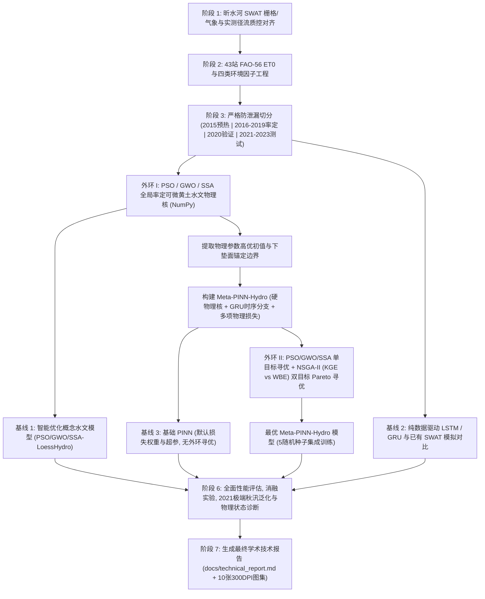
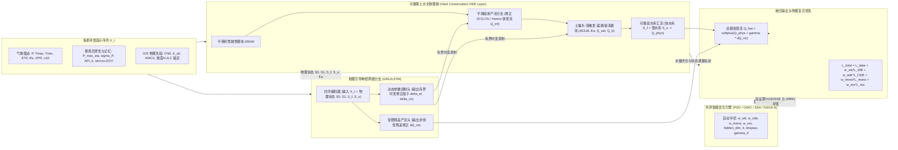

# 昕水河小流域物理信息-智能优化耦合降雨径流模型（Meta-PINN-Hydro）实施步骤手册

> **文档用途**：本手册为**可直接交付给后续 AI 编程助手或科研人员按步执行的完整工程与科研实施规范**，深度结合当前工作区中已提供的昕水河流域 SWAT+ 输入数据（`Xinshui_SWAT_Inputs/`），采用 **`pixi`** 进行环境管理，构建基于**可微水文物理核 + 物理信息神经网络（PINN） + 智能优化算法（PSO / GWO / SSA / NSGA-II）**的降雨径流模型，并自动生成包含**环境因子、模型架构、技术路线、模型性能**的完整学术级技术文档。

---

## 0. 文档定位与 AI 执行前置守则（Agent Execution Rules）

后续执行模型在读取并实施本手册时，必须严格遵守以下不可违背的工程与科研红线：

1. **严格按阶段顺序执行**：必须按 **Phase 0 → Phase 1 → Phase 2 → Phase 3 → Phase 4 → Phase 5 → Phase 6 → Phase 7** 依次实施；任一阶段未通过其“验收判据（Acceptance Criteria）”前，不得跳步进入下一阶段。
2. **原始 SWAT 数据只读保护**：`Xinshui_SWAT_Inputs/` 目录下的所有文件均视为**不可变原始输入（Read-Only）**，严禁修改、重命名、覆盖或删除其中任何文件。所有中间清洗、派生、对齐与建模产物必须写入新建的 `data/processed/`、`results/` 与 `docs/` 目录。
3. **统一使用 `pixi` 运行环境**：所有 Python 脚本、单元测试、建模训练与出图任务均必须通过 `pixi run <task>` 或 `pixi run python ...` 执行，禁止依赖系统全局 Python 或额外混用 `pip` 破坏环境锁文件。
4. **严禁数据泄漏（Zero Data Leakage）**：
   - 特征标准化器（`StandardScaler` / `MinMaxScaler`）与物理先验参数率定**仅允许在率定期（Calibration）拟合**；
   - 外环智能优化（PSO / GWO / SSA / NSGA-II）超参搜索与早停（Early Stopping）**仅允许使用率定期与验证期（Validation）信息**；
   - 独立测试期（Test，2021–2023 年，含 2021 年山西极端秋汛洪水）在整个寻优过程中必须**完全隔离**，仅在最终评估阶段执行一次前向推理。
5. **实事求是与结果可复现**：
   - 固定全局随机种子（如 `[42, 102, 202, 302, 402]`），保存每次运行配置快照与权重；
   - 严禁编造、篡改或美化任何水文评估指标、文献 DOI 或样本数；所有写入最终报告 `docs/technical_report.md` 的数字均必须**程序化读取自实际运行生成的 JSON/CSV 结果文件**。
6. **强制优先检查 P0 数据**：在进入 Phase 1 建模前，若缺失核心实测径流文件（见第 1.2 节 P0 清单），必须立即明确提示用户补充文件及所需格式，不得使用伪造或随机径流替代真实观测进行正式结论报告。

---

## 1. 已有 SWAT 数据全量盘点与新模型数据补充清单

### 1.1 已有 SWAT 输入数据核查清单（工作区实测审计结果）

当前工作区 `Xinshui_SWAT_Inputs/` 下已完整提供黄土高原典型流域**昕水河**的空间地理栅格/矢量数据与 9 年高分辨率格点逐日气象驱动数据。**文件选取原则**：优先采用 `projected/` 目录下已统一投影至 **`WGS_1984_UTM_Zone_49N`（`EPSG:32649`）** 的文件，忽略根目录未投影副本及带 `(1)` 后缀的重复副本。

| 数据类别 | 推荐优先读取路径 | 关键规格 / 空间与时间范围 / 统计特征（已核验） | 新模型用途与处理注意事项 |
| :--- | :--- | :--- | :--- |
| **30 m 数字高程模型 (DEM)** | `Xinshui_SWAT_Inputs/projected/Xinshui_DEM_30m_utm.tif` | 大小约 `24.3 MB` (`24,269,539 B`)；CRS: `EPSG:32649`；流域高程范围 `490.42 ~ 2014.28 m`（均值 `1224.66 m`） | 提取高程分位数、坡度分布、地形湿度指数（TWI）、集水几何特征；注意勿用未投影版及 `(1)` 重复文件 |
| **30 m 土地利用 (LULC)** | `Xinshui_SWAT_Inputs/projected/Xinshui_LULC_WorldCover_30m_utm.tif`<br>`Xinshui_SWAT_Inputs/projected/lookup_landuse_worldcover.csv` | 大小约 `22.3 MB`；ESA WorldCover 分类映射：`0/60=BARR`（裸地）, `10=FRSD`（林地）, `20=RNGB`（灌草）, `30=PAST`（草地）, `40=AGRL`（耕地）, `50=URBN`（建设）, `80=WATR`（水体）, `90=WETL`（湿地） | 统计下垫面组分比例；与土壤质地叠加估算先验径流曲线数 $\text{CN}_0$ 与植被冠层截留/蒸散发先验 |
| **30 m 土壤质地 (USDA)** | `Xinshui_SWAT_Inputs/projected/Xinshui_Soil_Texture_USDA_30m_utm.tif`<br>`Xinshui_SWAT_Inputs/projected/lookup_soil_texture_usda.csv` | 大小约 `9.5 MB`；USDA 12 级质地编码：`0/8=SIL`, `1=C`, `2=SIC`, `3=SC`, `4=CL`, `5=SICL`, `6=SCL`, `7=L`, `9=SI`, `10=SL`, `11=LS`, `12=S` | 提取流域土壤质地占比；结合 Saxton & Rawls (2006) 土壤传递函数推算土壤饱和导水率 $K_s$、田间持水量、凋萎系数与土壤蓄水上限先验 $S_{\max,0}$ |
| **流域边界与河网矢量** | `Xinshui_SWAT_Inputs/projected/xinshui_basin_boundary_utm.geojson`（或 `.shp`）<br>`Xinshui_SWAT_Inputs/projected/xinshui_river_network_utm.geojson`<br>`Xinshui_SWAT_Inputs/projected/xinshui_main_outlet.shp` | 范围 `110.4826°E–111.3933°E`, `36.1058°N–36.9579°N`；GeoJSON 实算多边形面积 **`4319.05 km²`**（属性 `sub_area = 4343.20 km²`）；主干流长 `63.51 km`，河道坡降 `0.00439`；总出口坐标 UTM49N `x=452315.24, y=4034401.63`（大宁县西入黄河口附近 `110.4826°E, 36.4676°N`） | 裁剪气象站点权重（泰森多边形 / Voronoi 面积加权）、界定汇流路径长度与时间滞后先验。**注意核实与实测水文站控制面积的一致性** |
| **43 站点逐日气象驱动** | `Xinshui_SWAT_Inputs/Xinshui_SWAT_Weather_Daily_2015_2023.csv`<br>`Xinshui_SWAT_Inputs/Xinshui_SWAT_Weather_Stations_Info.csv` | 大小约 `20.3 MB`；`43` 个 `~0.1°` 格点气象站（`110.6°E–111.3°E`, `36.15°N–36.95°N`，海拔 `624.96–1733.89 m`）；时间 `2015-01-01 ~ 2023-12-31` 共 `3,287` 天，`141,341` 行，**`0` 缺失值**。<br>`pcp`: `0.0000 ~ 91.9088 mm/d` (均值 `1.7448`)；`tmp_max`: `-16.8047 ~ 37.3793 °C` (均值 `15.4832`)；`tmp_min`: `-24.5976 ~ 24.6352 °C` (均值 `5.2103`)；`slr`: `0.8184 ~ 30.2682 MJ/(m²·d)` (均值 `16.0735`)；`wnd`: `0.0077 ~ 7.2439 m/s` (均值 `1.8573`)；`hmd`: `0.1191 ~ 0.9913` | 构筑流域加权气象输入、计算站级 FAO-56 Penman-Monteith 潜在蒸散发 $\text{ET}_0$ 与饱和水汽压差 $\text{VPD}$，并提取暴雨空间异质性因子。`Stations_Info(1).csv` 经校验与原文件 SHA256 完全一致，可忽略 |
| **SWAT+ 原生气象文件** | `Xinshui_SWAT_Inputs/swatplus_weather_cli/` | 与上述 43 站点一一对应的 `.cli` 文件（`pcp/tmp/slr/wnd/hmd`） | 可作为 SWAT+ 交叉核验参考，新模型直接读取更规整的 CSV 文件 |

> [!CAUTION]
> **两个关键数据陷阱（执行模型必查！）**：
> 1. **相对湿度 `hmd` 量纲为小数 `[0, 1]` 而非百分比 `[0, 100]`**：已实测 CSV 中 `hmd` 范围为 `0.1191 ~ 0.9913`（均值 `0.5425`）。计算 FAO-56 实际水汽压 $e_a = \text{hmd} \cdot e_s(T)$ 与 $\text{VPD}$ 时，**严禁再除以 100**，否则会导致 $\text{ET}_0$ 与 $\text{VPD}$ 严重失真！
> 2. **流域总出口 vs. 大宁水文站控制面积差异**：GeoJSON 流域全出口（入黄河口）面积为 `4319.05 km²`（属性 `4343.20 km²`），而文献中昕水河控制站**大宁水文站**的集水面积通常在 `3992 km²` 左右（大宁站位于入黄口上游）。流量（$\text{m}^3/\text{s}$）换算径流深（$\text{mm/d}$）时，$Q_{\text{mm/d}} = \frac{86.4 \times Q_{\text{m}^3/\text{s}}}{A_{\text{gauge}}}$，**必须严格按照实测水文站的实际集水面积 $A_{\text{gauge}}$ 换算并裁剪气象/GIS 统计掩膜**！

**已有气象序列年际气候特征统计（2015–2023，43 站面平均，已实测）**：

| 年份 | 天数 | 面平均年降水量 $P$ (mm) | 面平均气温 $T$ (°C) | 面平均太阳辐射 $R_s$ ($\text{MJ/(m}^2\cdot\text{d)}$) | 气候水文特征注记 |
| :---: | :---: | :---: | :---: | :---: | :--- |
| 2015 | 365 | 512.52 | 10.31 | 16.22 | 偏枯年份（建议作为模型预热期 Warm-up） |
| 2016 | 366 | 643.89 | 10.15 | 15.99 | 平水偏丰年份（率定期起始） |
| 2017 | 365 | 604.82 | 10.46 | 16.14 | 正常年份（率定期） |
| 2018 | 365 | 536.07 | 10.26 | 16.18 | 偏枯年份（率定期） |
| 2019 | 365 | 525.03 | 10.67 | 16.02 | 偏枯年份（率定期） |
| 2020 | 366 | 676.99 | 9.98 | 16.09 | 偏丰年份（建议作为验证期 Validation） |
| **2021** | **365** | **997.62** | **10.44** | **15.77** | **极端特丰洪涝年（2021 年山西极端秋汛！极佳的 OOD 极端泛化检验期）** |
| 2022 | 365 | 661.49 | 10.51 | 16.19 | 偏丰年份（独立测试期） |
| 2023 | 365 | 576.82 | 10.36 | 16.06 | 正常偏枯年份（独立测试期） |

---

### 1.2 构建新模型需要补充的数据清单（P0 / P1 / P2 分级）

目前已有的 `Xinshui_SWAT_Inputs/` 仅包含**降雨-气象强迫与下垫面物理特征**，**缺少水文模型率定与验证所需的出口断面实测径流目标变量，以及部分黄土高原过程机理增强数据**。请按以下优先级准备补充数据：

#### 1) P0 级：绝对必需数据（缺失则无法完成有监督水文建模）

| 序号 | 需补充数据 | 建议存放路径 | 字段与格式要求 | 获取建议 / 说明 |
| :---: | :--- | :--- | :--- | :--- |
| **P0-1** | **昕水河出口断面实测径流序列**（首选逐日；若只有逐月亦可兼容） | 逐日：`data/external/xinshui_observed_runoff.csv`<br>或逐月：`data/external/xinshui_observed_runoff_monthly.csv` | 覆盖 `2015-01-01 ~ 2023-12-31`（或其中连续子时段）；需注明单位为流量 `m3/s` 或径流深 `mm/d` | 来自《黄河水文年鉴》、山西省水文水资源勘测局（如**大宁水文站**实测径流资料），或已发表文献数字化提取 |
| **P0-2** | **水文站控制断面元数据** | 写入 `configs/watershed_meta.yaml` | `gauge_name`（如大宁水文站）、`gauge_lat`、`gauge_lon`、**`drainage_area_km2`**（如 `3992.0` vs 全流域 `4319.05`） | 用于精确换算 $Q_{\text{mm/d}}$ 与必要时按站址重划上游集水掩膜 |
| **P0-3** *(强烈建议)* | **您此前已跑通的 SWAT 模拟径流序列** | `data/external/swat_simulated_runoff.csv` | 含 `date` 与 `q_swat_m3s`（或 `q_swat_mm`），日或月尺度均可 | 从您已有 SWAT 项目的 `output.rch` / `channel_sd_day.txt` 导出，用于与新构建的 Meta-PINN-Hydro 进行**同流域直接基准对比** |

**P0 CSV 标准模板（请严格按此列名提供，日期格式 `YYYY-MM-DD` 或 `YYYY-MM`）：**

- **模板 A：逐日实测径流 `data/external/xinshui_observed_runoff.csv`**
```csv
date,q_obs_m3s
2015-01-01,1.85
2015-01-02,1.82
2015-01-03,1.80
```
*(若您的数据单位已是径流深 `mm/d`，可将列名命名为 `q_obs_mm`)*

- **模板 B：逐月实测径流降级兼容文件 `data/external/xinshui_observed_runoff_monthly.csv`**（当仅能获取月尺度水文年鉴数据时使用！模型依然在**逐日**物理步长上演算水文状态，在损失层自动按自然月累加后与月实测值对齐优化）：
```csv
year_month,q_obs_m3s
2015-01,1.84
2015-02,1.96
2015-03,2.45
```

- **模板 C：原有 SWAT 基线模拟对比文件 `data/external/swat_simulated_runoff.csv`**（可选）：
```csv
date,q_swat_m3s
2015-01-01,1.92
2015-01-02,1.88
```

#### 2) P1 级：强烈建议补充（均为公开免费数据，可显著增强黄土高原机理与消除“异参同效”）

| 序号 | 需补充数据 | 推荐公开来源 | 建议存放路径 | 对昕水河 PINN 模型的作用 |
| :---: | :--- | :--- | :--- | :--- |
| **P1-1** | **流域逐旬/逐月植被动态序列 (NDVI / LAI)** | Google Earth Engine / NASA Earthdata **MOD13Q1 (250 m NDVI, 16-day)** 或 **MOD15A2H (500 m LAI, 8-day)**（2015–2023） | `data/external/xinshui_modis_veg.csv`（列：`date,ndvi,lai`） | 昕水河属黄土高原退耕还林区，植被季节动态与年际恢复显著影响冠层截留与蒸散发过程；插值为逐日输入供神经参数调制头感知下垫面时变特性 |
| **P1-2** | **流域辅助蒸散发与土壤水再分析/遥感产品** | **ERA5-Land**（`swvl1-3` 表层至深层土壤水）+ **GLEAM / PML-V2 / MOD16A2**（实际蒸散发 $\text{ET}_a$）（2015–2023） | `data/external/xinshui_aux_et_sm.csv`（列：`date,et_aux_mm,sm_aux_m3m3`） | 作为**多物理弱监督物理约束** $\mathcal{L}_{\text{ET}}$ 与 $\mathcal{L}_{\text{SM}}$ 或独立验证基准，避免“产流对但蒸散发/土壤水失真”的水文异参同效问题 |
| **P1-3** | **定量土壤水力学属性栅格**（可选增强） | **SoilGrids 250m** 或 **HWSD v2.0**（砂/粉/黏粒含量 %、容重、土层深度） | `data/external/xinshui_soil_props.json` | 替代单纯质地类别查表；**若未提供，流水线将自动基于 `lookup_soil_texture_usda.csv` + Saxton & Rawls (2006) 经验公式无缝推算** |

#### 3) P2 级：进阶扩展数据（用于长期水文归因或工程干预分析）

- **P2-1 长序列历史气象与径流扩展**（例如扩展至 `2005–2023`）：当前气象数据共 9 年（2015–2023），若能补充 `2005–2014` 年气象与水文年鉴径流，可大幅扩充率定期样本并进一步提升跨年代气候非平稳泛化评估的统计置信度。
- **P2-2 黄土高原水土保持工程元数据**：如**淤地坝控制面积比例、梯田面积占比、灌区/工业取用水估算量**（`configs/watershed_meta.yaml` 中登记）。若流域内存在大型淤地坝拦蓄或明显人工取水，模型可启用“受限人类活动残差修正门控”并在机理报告中予以量化解释。

> **降级运行契约（Graceful Degradation Contract）**：只要 **P0（实测径流 + 站点控制面积）** 到位，本手册中的 **Phase 0 至 Phase 7 可 100% 自动跑通**；P1 与 P2 数据若就绪则自动激活对应特征通道与多物理弱监督约束，缺失时自动平滑降级为基于 SWAT 已有数据+物理核自举模式，绝不阻塞主流程。

---

## 2. 模型构建的文献可行性支撑（全部经 DOI 核验）

本技术方案融合**“黄土高原混合产流可微物理核 + 物理信息神经网络（PINN） + 群智能/多目标优化算法（PSO/GWO/SSA/NSGA-II）”**，所有关键科学假设与架构选择均具备明确的国际顶级期刊实证支撑：

| 论证维度 | 文献作者与期刊 | 已核验 DOI / ISBN | 对昕水河模型构建的直接支撑作用 |
| :--- | :--- | :--- | :--- |
| **PINN 基础理论** | Raissi, M., Perdikaris, P., & Karniadakis, G. E. (2019). *J. Comput. Phys.*, 378, 686–707. | `10.1016/j.jcp.2018.10.045` | 确立将物理控制微分方程（ODE/PDE）残差作为正则化约束嵌入神经网络损失函数的 PINN 核心方法论。 |
| **物理信息机器学习体系** | Karniadakis, G. E. et al. (2021). *Nature Reviews Physics*, 3, 422–440. | `10.1038/s42254-021-00314-5` | 系统分类“观测偏置、归纳偏置、学习偏置”三条融合路径，为本模型同时采用**硬结构物理层（归纳偏置）+ 物理残差损失（学习偏置）**提供顶层框架。 |
| **概念水文模型与神经网络共生耦合 (P-RNN)** | Jiang, S., Zheng, Y., & Solomatine, D. (2020). *Geophysical Research Letters*, 47, e2020GL088229. | `10.1029/2020GL088229` | 首次将经典概念水文模型 **EXP-HYDRO**（Patil & Stieglitz, 2014, `10.1002/hyp.9660`；参考教学基准 HBV：`10.5194/hess-16-3315-2012`）重写为可微循环层并与神经网络耦合，证实其在保持水文机理解释性的同时超越纯物理和纯黑箱模型。 |
| **可微水文建模与参数动态化 ($\delta$-Model)** | Feng, D., Liu, J., Lawson, K., & Shen, C. (2022). *Water Resources Research*, 58, e2022WR032404. | `10.1029/2022WR032404` | 证明在 PyTorch 自动微分框架中构建可微概念物理核并由神经网络动态调制关键参数，可在保证水量守恒的同时逼近纯 LSTM 精度，并输出土壤水、蒸散发等多物理诊断变量。 |
| **地学可微建模范式与小样本外推** | Shen, C. et al. (2023). *Nature Reviews Earth & Environment*, 4, 552–567. | `10.1038/s43017-023-00450-9` | 论证可微物理-AI 混合模型在**9 年中小样本流域数据**与**气候非平稳外推**（如 2021 年极端暴雨）下具备显著高于纯数据驱动模型的物理一致性与稳健性。 |
| **质量守恒结构与极端洪水泛化** | Hoedt, P.-J. et al. (2021). *ICML 2021* (MC-LSTM); Frame, J. M. et al. (2022). *HESS*, 26, 3377–3392; Bhasme, P. et al. (2022). *J. Hydrol.*, 615, 128618. | `10.48550/arXiv.2101.05186` / `10.5194/hess-26-3377-2022` / `10.1016/j.jhydrol.2022.128618` | 证明在网络内生嵌入质量守恒与物理一致性约束，能够避免极端暴雨/特枯期预测出现非物理发散。 |
| **为何必须耦合智能优化算法** | Wang, S., Teng, Y., & Perdikaris, P. (2021). *SIAM J. Sci. Comput.*, 43(5), A3055–A3081. | `10.1137/20M1318043` | 揭示 PINN 多项复合损失因量纲和数值刚性差异极易产生“梯度病理（Gradient Pathologies）”，从机理上证明**引入外环智能优化自动寻优物理损失权重与网络超参数**的必要性。 |
| **群智能优化 + 径流模型实证** | Xu, Y. et al. (2022). *J. Hydrol.*, 608, 127553 (PSO-LSTM); Tikhamarine, Y. et al. (2020). *J. Hydrol.*, 589, 125133; *J. Hydrol.* (2023), 129977 & *AIP Adv.* (2025) (SSA). | `10.1016/j.jhydrol.2022.127553` / `10.1016/j.jhydrol.2020.125133` / `10.1016/j.jhydrol.2023.129977` / `10.1063/5.0293933` | 实证表明 **PSO、GWO、SSA** 等元启发式算法能有效跃出参数局部最优并提升径流仿真精度。四大经典优化算法原始文献：PSO (`10.1109/ICNN.1995.488968`)、GWO (`10.1016/j.advengsoft.2013.12.007`)、SSA (`10.1080/21642583.2019.1708830`)、NSGA-II (`10.1109/4235.996017`)。 |
| **水文基准体系与评价准则** | Addor, N. et al. (2017). *HESS*; Kratzert, F. et al. (2019). *HESS*; Nash & Sutcliffe (1970); Gupta et al. (2009). | `10.5194/hess-21-5293-2017` / `10.5194/hess-23-5089-2019` / `10.1016/0022-1694(70)90255-6` / `10.1016/j.jhydrol.2009.08.003` | 确立 CAMELS 环境因子标准框架与 NSE、KGE 及其三分量（$r, \alpha, \beta$）、高水偏差 FHV、低水偏差 FLV 评价指标体系。 |
| **蒸散发与土壤水力学参数化** | Saxton, K. E., & Rawls, W. J. (2006). *Soil Sci. Soc. Am. J.*, 70, 1569–1578; Allen, R. G. et al. (1998). FAO-56. | `10.2136/sssaj2005.0117` / ISBN `92-5-104219-5` | 为直接从昕水河 43 站气象计算 **FAO-56 Penman-Monteith $\text{ET}_0$** 及从 USDA 土壤质地栅格推算水力学先验参数提供权威公式。 |
| **昕水河流域本地水文研究支撑** | *Water* (2020) 昕水河 SWAT 过程模拟；*Water* (2016) 昕水河流域径流变化归因研究。 | `10.3390/w12030878` / `10.3390/w8060267` | 直接证实昕水河（约 `4000 km²` 级黄土丘陵沟壑区中尺度/小流域尺度）存在显著“气候-下垫面退耕还林协同驱动”与蓄满-超渗混合产流特征，需兼顾土壤水与地表快径流刻画。 |

---

## 3. 面向昕水河的环境因子体系与提取规范

基于您已提供的 30 m DEM、WorldCover LULC、USDA Soil 及 43 个网格气象站，模型将自动构建以下**四大类环境因子矩阵**，并在最终报告中输出全量统计表、Pearson/Spearman 相关性热力图、互信息（MI）排序与 PINN 输入梯度敏感性归因：

| 因子类别 | 因子名称与符号 | 单位 | 提取来源与计算方法 | 水文物理机制 |
| :--- | :--- | :--- | :--- | :--- |
| **1. 流域面平均动态气象强迫** | 日降水量 $P_{\text{basin}}$ | $\text{mm/d}$ | 43 站点按流域边界内泰森多边形（Voronoi）面积加权 | 核心水分输入通量 |
| | 日最高/最低/平均气温 $T_{\max}, T_{\min}, T_{\text{mean}}$ | $^\circ\text{C}$ | 43 站面积加权，$T_{\text{mean}} = 0.5(T_{\max}+T_{\min})$ | 控制冬季（低至 `-24.6 °C`）冻融积雪与春季融雪、蒸散发速率 |
| | 短波太阳辐射 $R_s$、10 m 风速 $u_{10}$、相对湿度 $\text{RH}$ | $\text{MJ/(m}^2\cdot\text{d)}, \text{m/s}, -$ | 直接读取 `slr, wnd, hmd`（注意 `hmd` 保持 `[0,1]`）并面积加权 | 驱动地表能量分配与空气动力学蒸发项 |
| | **饱和水汽压差 $\text{VPD}$** | $\text{kPa}$ | $e_s = 0.5[e^0(T_{\max}) + e^0(T_{\min})]$，$\text{VPD} = e_s(1 - \text{hmd})$ | 刻画黄土高原半干旱大气干热胁迫与蒸腾拉动势 |
| | **FAO-56 参考作物蒸散 $\text{ET}_0$ ($\text{PET}$)** | $\text{mm/d}$ | 逐站结合 `latitude`, `elevation_m` 按 Allen et al. (1998) FAO-56 Penman-Monteith 公式精确计算后再面加权 | 消除单纯温度经验法偏差，精确界定流域潜在蒸发上限 |
| **2. 黄土高原暴雨空间异质性因子** | 上/中/下游分区面雨量 $P_{\text{up}}, P_{\text{mid}}, P_{\text{low}}$ | $\text{mm/d}$ | 按站点高程或距出口距离分三带求平均 | 反映不同海拔与汇流距离区间的暴雨落区差异 |
| | 站间最大日雨量 $P_{\max,\text{sta}}$、标准差 $\sigma_P$、有效降雨覆盖率 $f_{\text{rain}}$ | $\text{mm/d}, \text{mm/d}, -$ | 每日跨 43 站统计（$P_{\text{sta}} \ge 1.0\ \text{mm/d}$ 的站点比例） | **关键因子**：黄土高原夏季多局地强对流短历时暴雨，即使全流域平均雨量不大，局部强降雨中心仍可触发显著超渗洪峰 |
| **3. 水文前期记忆与物候周期因子** | 多尺度前期降雨指数 $\text{API}_{3,7,15,30}$ | $\text{mm}$ | $\text{API}_k(t) = \sum_{i=1}^{k} 0.85^{i-1} P_{t-i}$ | 代理表层与深层前期土壤湿润度（Antecedent Soil Moisture） |
| | 滑动累计水分盈亏 $(P - \text{ET}_0)_{7,30}$ | $\text{mm}$ | 过去 7 天与 30 天累计水量净盈余 | 捕捉干旱蓄水亏缺与连续阴雨（如 2021 秋汛）饱和累积效应 |
| | 年内物候周期编码 $\sin(\frac{2\pi\cdot\text{DOY}}{365.25}), \cos(\frac{2\pi\cdot\text{DOY}}{365.25})$ | 无量纲 | 日序数周期编码 | 隐式表征太阳高度角与植被物候；若提供 **P1-1 MODIS NDVI/LAI** 则同步纳入实测动态植被通道 |
| **4. 下垫面静态物理与先验参数因子** | 流域面积 $A$、高程分位数 $Z_{10,50,90}$、平均坡度 $\bar{S}$、地形湿度指数 $\overline{\text{TWI}}$、主河道坡降与河长 | $\text{km}^2, \text{m}, ^\circ, -$ | 由 `Xinshui_DEM_30m_utm.tif` 与河网矢量自动计算 | 界定产汇流滞时 $k_f, k_s$ 与地形蓄水空间分异 |
| | LULC 各类型面积比例（`FRSD`, `RNGB`, `PAST`, `AGRL`, `URBN`, `BARR`） | $\%$ | 由 `Xinshui_LULC_WorldCover_30m_utm.tif` + lookup 表自动统计 | 决定植被蒸散发权重与地表糙率 |
| | USDA 土壤质地面积比例与推导参数（砂/粉/黏粒加权含量、先验曲线数 $\text{CN}_0$、Saxton-Rawls 饱和导水率 $K_{s,0}$、有效持水量 $\text{AWC}_0$） | $\%, \text{mm/h}, \text{mm}$ | 由 `Xinshui_Soil_Texture_USDA_30m_utm.tif` 与 LULC 栅格像元级叠加推导 | **硬锚定物理核边界与初值**：使 30 m SWAT 栅格信息直接转化为可微水文核的先验约束 |

---

## 4. Meta-PINN-Hydro 模型架构与技术路线（黄土高原蓄满-超渗混合适配）

### 4.1 端到端技术路线图



### 4.2 Meta-PINN-Hydro 核心网络与耦合架构

针对昕水河**“黄土高原半湿润-半干旱过渡带、冬季有冻雪、夏季多局地强降雨兼有超渗产流与蓄满/基流过程”**的特点，对通用 EXP-HYDRO 升级为 **可微黄土高原混合产流物理核（Differentiable Loess-Hydro Core）**：



#### 核心数学机制说明

1. **可微物理核关键方程（保证全时间步长梯度光滑可微与严格质量守恒）**：
   - **积雪消融（应对冬季最低 `-24.6 °C`）**：
     $$P_{\text{snow}}(t) = P(t)\cdot\sigma\!\left(\frac{T_{\text{th}} - T_{\text{mean}}(t)}{\tau_T}\right), \quad M(t) = \min\!\Big(S_0(t),\; D_f\cdot \operatorname{softplus}\big(T_{\text{mean}}(t) - T_m\big)\Big)$$
     $$S_0(t+1) = S_0(t) + P_{\text{snow}}(t) - M(t), \quad P_{\text{eff}}(t) = P(t) - P_{\text{snow}}(t) + M(t)$$
   - **超渗快径流分支（黄土丘陵夏季短历时暴雨适配，可微修正 SCS-CN）**：
     结合下垫面先验曲线数 $\text{CN}_0$ 与神经网络动态调制 $\delta_{\text{cn}}(t) \in (-0.25, +0.25)$ 得到瞬时潜在最大滞留量 $S_{\text{pot}}(t)$，令初损 $I_a(t) = \lambda_{ia} S_{\text{pot}}(t) \cdot \big(1 - 0.5\frac{S_1(t)}{S_{\max}}\big)$（反映前期土壤含水对产流门槛的动态调制）：
     $$Q_{\text{inf}}(t) = \frac{\big[\operatorname{softplus}(P_{\text{eff}}(t) - I_a(t))\big]^2}{\operatorname{softplus}(P_{\text{eff}}(t) - I_a(t)) + S_{\text{pot}}(t) + \epsilon}, \quad F_{\text{in}}(t) = P_{\text{eff}}(t) - Q_{\text{inf}}(t)$$
   - **土壤蓄水、蒸散发与基流/蓄满产流**：
     $$E_a(t) = \alpha_{\text{et}}(t)\cdot \text{ET}_0(t)\cdot \min\!\left(1,\; \frac{S_1(t)}{S_{\max}}\right), \quad Q_b(t) = Q_{\max}\exp\!\Big(-f\cdot \max\big(0,\; S_{\max} - S_1(t)\big)\Big)$$
     $$Q_{\text{sat}}(t) = \operatorname{softplus}\!\big(S_1(t) + F_{\text{in}}(t) - E_a(t) - Q_b(t) - S_{\max}\big)$$
     $$S_1(t+1) = \operatorname{clamp}\!\big(S_1(t) + F_{\text{in}}(t) - E_a(t) - Q_b(t) - Q_{\text{sat}}(t),\; 0,\; S_{\max}\big)$$
   - **双线性水库可微汇流（分别刻画坡面/河道快速洪水波与地下基流慢速退水）**：
     $$S_f(t+1) = (1 - k_f)\big(S_f(t) + Q_{\text{inf}}(t) + Q_{\text{sat}}(t)\big), \quad Q_f(t) = k_f\big(S_f(t) + Q_{\text{inf}}(t) + Q_{\text{sat}}(t)\big)$$
     $$S_s(t+1) = (1 - k_s)\big(S_s(t) + Q_b(t)\big), \quad Q_s(t) = k_s\big(S_s(t) + Q_b(t)\big)$$
     $$Q_{\text{phys}}(t) = Q_f(t) + Q_s(t)$$
   - 所有物理基参数 $\{T_{\text{th}}, T_m, D_f, \lambda_{ia}, \text{CN}_{\text{scale}}, S_{\max}, Q_{\max}, f, \alpha_{\text{et},0}, k_f, k_s\}$ 均通过 Sigmoid 约束在根据昕水河 DEM/LULC/USDA Soil 先验设定的水文合理区间内。

2. **多物理复合损失函数（自动兼容逐日或逐月实测观测）**：
   $$\mathcal{L}_{\text{total}} = \mathcal{L}_{\text{data}} + \lambda_{\text{wb}}\mathcal{L}_{\text{WB}} + \lambda_{\text{ode}}\mathcal{L}_{\text{ODE}} + \lambda_{\text{mono}}\mathcal{L}_{\text{mono}} + \lambda_{\text{res}}\mathcal{L}_{\text{res}}\; \big(+\; \lambda_{\text{aux}}\mathcal{L}_{\text{ET/SM}}\big)$$
   - **$\mathcal{L}_{\text{data}}$**：若提供逐日径流，采用 `0.65 * NSE_Loss + 0.35 * LogMSE_Loss` 兼顾洪峰与枯季退水；**若仅提供逐月实测径流（P0 模板 B）**，则先在逐日时间步积分出全月径流深 $\hat{Q}_m = \sum_{t\in m}\hat{Q}_t$（或月均流量），再于月尺度计算 NSE + LogMSE 损失，实现**日尺度假定机理演化 + 月尺度实测约束反演**！
   - **$\mathcal{L}_{\text{WB}}$（水量平衡闭包约束）**：在 30 天滑动窗口及全模拟段强制满足总水量守恒 $\big(\sum (P - E_a - \hat{Q}) - \Delta(S_0 + S_1 + S_f + S_s)\big)^2$。
   - **$\mathcal{L}_{\text{ODE}}$（通量-状态一致性残差）**：惩罚修正后径流 $\hat{Q}_t$ 与物理核连续时间离散通量关系间的非物理偏离。
   - **$\mathcal{L}_{\text{mono}}$（无雨退水单调约束）**：在无有效降雨且无融雪日（$P_{\text{eff}}(t) < 0.2\ \text{mm/d}$）施加 $\frac{1}{|D_{\text{dry}}|}\sum_{t\in D_{\text{dry}}}\max(0, \hat{Q}_t - \hat{Q}_{t-1})^2$，消除黑箱网络在干季的毛刺跳变。
   - **$\mathcal{L}_{\text{res}}$（残差受限正则项）**：惩罚 $\mathbb{E}[(\gamma \cdot \Delta Q_{\text{nn}})^2]$，确保物理机理占主导地位，防止网络退化为无物理意义的数据拟合器。
   - **$\mathcal{L}_{\text{ET/SM}}$（可选 P1 弱监督项）**：当存在 P1 遥感/再分析 $\text{ET}_a$ 或土壤水数据时自动激活，否则权重置零。

3. **双层智能优化协同策略**：
   - **外环 I（物理先验寻优）**：采用 **PSO、GWO、SSA** 三算法在向量化 NumPy 物理核上独立寻优（种群 `30` × `80` 代），获得物理参数最优解 $\theta_{\text{phys}}^*$，作为强基线并用于初始化 PINN 物理核。
   - **外环 II（PINN 超参/权重协同寻优）**：
     - **单目标三算法横向对比**：在 RTX 4050 GPU 上分别以 **PSO、GWO、SSA** 优化 8 维混合空间 $[\lambda_{\text{wb}}, \lambda_{\text{ode}}, \lambda_{\text{mono}}, \lambda_{\text{res}}, \text{hidden\_dim}, \log\eta, \text{dropout}, \gamma_0]$（目标为验证期综合得分 $J = 0.5\cdot\text{KGE}_{\text{val}} + 0.5\cdot\text{NSE}_{\text{val}} - 0.15\cdot|\text{WBE}_{\text{val}}|$）；
     - **多目标 Pareto 优化**：以 **NSGA-II** 同步优化双目标 $f_1 = 1 - \text{KGE}_{\text{val}}$ 与 $f_2 = |\text{WBE}_{\text{val}}|$，求解“径流拟合精度 vs. 水量平衡守恒”真实 Pareto 前沿，在归一化最小欧氏距离膝点（Knee Point）处锁定最终推荐超参，并完成 5 随机种子训练与 90% 置信区间量化。

---

## 5. `pixi` 环境管理配置与标准项目目录结构

### 5.1 推荐 `pixi.toml` 完整配置模板（适配 Windows 64 + CUDA + GIS 科学栈）

> **设计要点**：GIS 底层二进制依赖（`rasterio`, `geopandas`, `shapely`, `pyproj` 等，依赖 GDAL/PROJ/GEOS）统一由 **`conda-forge`** 渠道解析安装以避免 Windows 编译冲突；深度学习框架 **PyTorch CUDA 轮子**通过 `[pypi-options]` 与 `[pypi-dependencies]` 从 PyTorch 官方 CUDA 仓库拉取，充分调用本机 **RTX 4050（Driver CUDA 13.2）**。

```toml
[workspace]
name = "xinshui-pinn-hydro"
version = "0.1.0"
description = "Meta-PINN-Hydro rainfall-runoff modeling for Xinshui River basin"
channels = ["conda-forge"]
platforms = ["win-64"]

[system-requirements]
cuda = "12.4"

[dependencies]
python = "3.12.*"
numpy = ">=1.26,<2.2"
scipy = ">=1.13"
pandas = ">=2.2"
scikit-learn = ">=1.5"
rasterio = ">=1.3"
geopandas = ">=1.0"
shapely = ">=2.0"
pyproj = ">=3.6"
matplotlib = ">=3.9"
seaborn = ">=0.13"
pyyaml = ">=6.0"
openpyxl = ">=3.1"
tqdm = ">=4.66"
pytest = ">=8.2"

[pypi-options]
extra-index-urls = ["https://download.pytorch.org/whl/cu126"]

[pypi-dependencies]
torch = ">=2.5,<2.9"

[tasks]
check-env = "python -c \"import torch, rasterio, geopandas; print('PyTorch:', torch.__version__, 'CUDA:', torch.cuda.is_available(), torch.cuda.get_device_name(0) if torch.cuda.is_available() else 'CPU'); print('GIS OK:', rasterio.__version__, geopandas.__version__)\""
test = "pytest -v tests/"
prepare-data = "python scripts/01_prepare_data.py"
train-baselines = "python scripts/02_train_baselines.py"
tune-pinn = "python scripts/03_optimize_pinn.py"
train-final = "python scripts/04_train_final_and_ablation.py"
evaluate-report = "python scripts/05_evaluate_and_report.py"
```

### 5.2 标准目标工程目录树

后续按阶段施工后，工作区结构如下（蓝色/标注为已有只读数据，其余为按本手册逐步创建）：

```text
f:\Users\20104\Desktop\model\
├── IMPLEMENTATION_STEPS.md              # 本实施步骤手册
├── pixi.toml                            # Pixi 环境与任务定义
├── pixi.lock                            # Pixi 自动生成的精确环境锁文件
├── Xinshui_SWAT_Inputs/                 # [只读] 用户已有 SWAT 输入数据集
├── configs/
│   ├── watershed_meta.yaml              # 昕水河水文站控制面积、坐标及外部数据路径登记
│   └── experiment_config.yaml           # 切分时段、物理边界、超参搜索空间、随机种子配置
├── data/
│   ├── external/                        # 用户需放入的 P0/P1 外部数据 (实测径流/SWAT对比/NDVI等)
│   └── processed/                       # 提取的GIS流域属性、逐日环境因子特征表与切分缓存
├── src/
│   ├── data/
│   │   ├── gis_extractor.py             # DEM/LULC/Soil 栅格属性与先验 CN0/水力学参数计算
│   │   ├── meteo_et0.py                 # 43站 Voronoi 加权、FAO-56 ET0、暴雨空间异质性计算
│   │   └── dataset.py                   # 标准化器(严格仅fit率定期)、序列切分与日/月观测适配器
│   ├── physics/
│   │   ├── loess_hydro_np.py            # NumPy 向量化黄土高原混合产汇流物理核
│   │   └── diff_loess_hydro.py          # PyTorch 可微黄土物理核 (nn.Module)
│   ├── models/
│   │   ├── baselines.py                 # 纯数据驱动 LSTM / GRU 基线模型
│   │   ├── pinn_hydro.py                # Meta-PINN-Hydro 混合模型架构
│   │   └── losses.py                    # 日/月自适应复合物理信息损失函数
│   ├── optimization/
│   │   ├── metaheuristics.py            # PSO / GWO / SSA 自研可追踪优化器
│   │   ├── nsga2_optimizer.py           # NSGA-II 双目标 Pareto 优化器
│   │   └── bilevel_tuner.py             # 外环智能优化与内环 GPU 训练调度器
│   └── evaluation/
│       ├── metrics.py                   # NSE, KGE(r,a,b), R2, RMSE, MAE, PBIAS, FHV, FLV, WBE
│       ├── diagnostics.py               # 消融实验、2021极端洪水泛化、小样本测试、物理状态/梯度归因
│       └── plotting.py                  # 10 张 300 DPI 中英文兼容出版级图集生成
├── scripts/
│   ├── 01_prepare_data.py
│   ├── 02_train_baselines.py
│   ├── 03_optimize_pinn.py
│   ├── 04_train_final_and_ablation.py
│   └── 05_evaluate_and_report.py
├── tests/
│   ├── test_physics_conservation.py
│   ├── test_optimizers.py
│   └── test_pipeline_smoke.py
├── results/
│   ├── checkpoints/                     # 优化物理参数、最佳超参 JSON、多种子模型权重
│   ├── metrics/                         # 各基线/消融/优化器轨迹/Pareto前沿定量 CSV/JSON
│   └── figures/                         # 10 张 300 DPI PNG & SVG 高清图件
└── docs/
    └── technical_report.md              # 最终交付的学术级完整技术文档
```

---

## 6. 分阶段实施步骤手册（Phase 0 ~ Phase 7）

> 后续执行时，请按以下每个 Phase 的**输入依赖 → 核心实现规范 → 执行命令 → 验收判据**逐项推进。

---

### Phase 0：Pixi 环境初始化与软硬件核验

- **目标文件**：`pixi.toml`、`configs/watershed_meta.yaml`、`configs/experiment_config.yaml`
- **关键实施步骤**：
  1. 根据第 5.1 节模板创建 `pixi.toml`（注意不要使用已废弃的旧版 `[project]` 字段，Pixi 0.80 推荐 `[workspace]`）。
  2. 执行 `pixi install` 解析并安装环境，生成 `pixi.lock`。
  3. 验证 `torch.cuda.is_available()` 为 `True`（识别 `NVIDIA GeForce RTX 4050 Laptop GPU`），且 `rasterio`、`geopandas`、`pyproj`、`scipy`、`matplotlib` 全部可正常导入。
  4. 建立 `data/external/` 与 `configs/watershed_meta.yaml`，检查 `data/external/` 中是否存在 P0 实测径流文件（`xinshui_observed_runoff.csv` 或 `xinshui_observed_runoff_monthly.csv`）。**若 P0 缺失，立即停止并向用户报告所需 CSV 模板与位置，待用户放入后再继续 Phase 1**。
- **执行命令**：
  ```powershell
  pixi install
  pixi run check-env
  ```
- **验收判据**：
  - `pixi run check-env` 退出码为 `0`，输出 `CUDA: True` 且显示 `RTX 4050`，GIS 库导入无 DLL 错误；
  - `Xinshui_SWAT_Inputs/` 完整无损；P0 实测径流数据及控制面积参数已在 `configs/watershed_meta.yaml` 中校验就绪。

---

### Phase 1：SWAT GIS/气象多源提取与环境因子工程

- **目标文件**：`src/data/gis_extractor.py`、`src/data/meteo_et0.py`、`scripts/01_prepare_data.py`
- **关键实施步骤**：
  1. **GIS 静态与物理先验提取（`gis_extractor.py`）**：
     - 读取 `projected/` 下的矢量与 30 m 栅格（`EPSG:32649`）。若用户提供了独立于全流域出口的水文站坐标（如大宁水文站）及控制面积，先验证/掩膜匹配上游集水区统计范围。
     - 从 `Xinshui_DEM_30m_utm.tif` 计算高程均值/中位数/5%–95% 分位数、平均坡度（Horn 梯度法）、平均 $\text{TWI} = \ln(a/\tan\beta)$ 与河网长度/坡降。
     - 从 `Xinshui_LULC_WorldCover_30m_utm.tif` + `lookup_landuse_worldcover.csv` 统计林/草/耕/裸/建面积百分比。
     - 从 `Xinshui_Soil_Texture_USDA_30m_utm.tif` + `lookup_soil_texture_usda.csv` 统计土壤质地分布，叠加 LULC 像元查表计算流域面积加权先验曲线数 $\text{CN}_0$，并结合 **Saxton & Rawls (2006)** 传递函数（若无 P1-3 SoilGrids 数据）推算砂/粉/黏粒加权含量、饱和导水率 $K_{s,0}$ 与有效蓄水深度先验 $S_{\max,0}$。
     - 导出至 `data/processed/xinshui_static_attributes.json`。
  2. **43 站气象加权与 $\text{ET}_0$/异质性计算（`meteo_et0.py`）**：
     - 读取 `Xinshui_SWAT_Weather_Daily_2015_2023.csv` 与 `Xinshui_SWAT_Weather_Stations_Info.csv`；强制断言 `hmd` 位于 `[0, 1]` 区间。
     - 基于流域边界几何计算 43 个气象站点的 **Voronoi 面积权重**（位于边界外的站点仅保留其落入流域内的交集面积权重，归一化总和为 1）。
     - **逐站逐日**利用 `tmp_max, tmp_min, slr, wnd, hmd` 与站点 `latitude, elevation_m` 计算 **FAO-56 Penman-Monteith $\text{ET}_0$**（$\text{mm/d}$）及 $\text{VPD}$（$\text{kPa}$），再按 Voronoi 权重合成流域面平均气象强迫。
     - 提取暴雨空间异质性因子：$P_{\text{up}}, P_{\text{mid}}, P_{\text{low}}$（按站点高程三分位分区均值）、$P_{\max,\text{sta}}$、$\sigma_P$、$f_{\text{rain}}$。
     - 计算 $\text{API}_{3,7,15,30}$、$(P-\text{ET}_0)_{7,30}$ 及 $\sin/\cos(\text{DOY})$；若存在 `P1-1` MODIS NDVI/LAI，以样条/线性插值为逐日特征并拼接。
  3. **实测径流与可选数据对齐**：
     - 读取 P0 实测径流（自动识别逐日/逐月及流量/径流深单位），统一换算为径流深 $\text{mm/d}$（逐月则存储月观测值表并生成逐日-逐月索引映射矩阵）。
     - 同步计算所有环境因子描述性统计（均值、标准差、偏度、极值）、Pearson/Spearman 相关矩阵与互信息（MI）排名，保存 `data/processed/xinshui_daily_features.parquet`（或 `.csv`）与 `data/processed/env_factor_stats.csv`。
- **执行命令**：
  ```powershell
  pixi run prepare-data
  ```
- **验收判据**：
  - `data/processed/xinshui_daily_features.csv` 精确涵盖 `2015-01-01 ~ 2023-12-31` 共 `3,287` 天，零缺失值；
  - 验证期与全序列 FAO-56 年平均 $\text{ET}_0$ 落于黄土高原晋西物理合理范围（通常约 `850 ~ 1150 mm/yr`）；
  - 静态属性 JSON 清晰记录 $\text{CN}_0$、各 LULC/Soil 占比及 Voronoi 权重总和 $= 1.0000 \pm 10^{-6}$。

---

### Phase 2：防泄漏时序切分与实验设计配置

- **目标文件**：`src/data/dataset.py`、`configs/experiment_config.yaml`
- **关键实施步骤**：
  1. **主实验严格时间切分（共计 9 年 `2015–2023`）**：
     - **预热期（Warm-up）**：`2015-01-01 ~ 2015-12-31`（1 年，365 天）— 仅用于消弭初始土壤水/积雪状态 $S_0(0), S_1(0)$ 假定误差，**不计入任何训练损失与评估指标**；
     - **率定期（Calibration / Train）**：`2016-01-01 ~ 2019-12-31`（4 年，1,461 天，含丰平枯不同年景，年雨量 `525 ~ 644 mm`）；
     - **验证期（Validation）**：`2020-01-01 ~ 2020-12-31`（1 年，366 天，年雨量 `677 mm`）— 用于外环智能优化目标评估与早停；
     - **独立测试期（Independent Test）**：`2021-01-01 ~ 2023-12-31`（3 年，1,095 天）— **包含 2021 年山西特大秋汛年（`997.62 mm`）**，可直接评估模型在历史未见极值强降雨（Out-of-Distribution）下的物理外推能力！
  2. **补充交叉验证与小样本压力测试配置**：
     - 在配置中登记 **50% 小样本压力实验**（仅使用 `2018–2019` 两年率定，仍在 `2021–2023` 测试），以定量验证 PINN 相比纯 LSTM 在少样本下的泛化优势；
     - 若 P0 仅为逐月实测径流，在 `dataset.py` 中构造 `month_group_ids` 与掩膜张量，使模型按日循环推演整个连续时段后，精确按自然月聚合求损失。
  3. **标准化防泄漏实现**：`FeatureScaler.fit(X_train)` 严禁接触 `2020–2023` 任何样本；径流观测值采用原始物理量纲 $\text{mm/d}$ 计算水文物理损失。
- **验收判据**：
  - 单元测试/断言检查训练集中不包含任何 `>= 2020-01-01` 日期，验证集不包含 `>= 2021-01-01` 日期；
  - `StandardScaler` 的 `mean_` 与 `scale_` 严格等于率定期统计量。

---

### Phase 3：可微黄土水文物理核与第一阶段物理先验率定

- **目标文件**：`src/physics/loess_hydro_np.py`、`src/physics/diff_loess_hydro.py`、`src/optimization/metaheuristics.py`、`tests/test_physics_conservation.py`
- **关键实施步骤**：
  1. 实现纯 NumPy 向量化物理核 `loess_hydro_np.py` 与 PyTorch `nn.Module` 可微物理核 `diff_loess_hydro.py`（严格共享第 4.2 节公式与参数 Sigmoid 边界映射，物理边界由 Phase 1 提取的 $\text{CN}_0, S_{\max,0}$ 锚定）。
  2. **编写并运行物理核单元校验测试 `tests/test_physics_conservation.py`**：
     - **前向等价性**：随机抽样 5 组参数，在 1000 天强迫上对比 NumPy 与 PyTorch 无神经调制状态下的输出，要求最大绝对误差 $< 10^{-5}\ \text{mm/d}$；
     - **严格质量守恒**：检验全局水量闭合残差 $\big|\sum P - \sum E_a - \sum Q_{\text{phys}} - \Delta(S_0 + S_1 + S_f + S_s)\big| < 10^{-3}\ \text{mm}$；
     - **全链路梯度可微性**：反向传播计算所有物理参数（`grad is not None` 且非全零、无 `NaN`/`Inf`）。
  3. **实现外环 I 优化算法引擎（`metaheuristics.py`）**：
     - 完整手写透明、可记录逐代收敛历史的 **PSO**（惯性权重线性递减）、**GWO**（$\alpha, \beta, \delta$ 三头狼动态包围）、**SSA**（发现者-加入者-警戒者机制）。
     - 在 NumPy 物理核上独立运行三算法率定概念参数（率定期最大化 KGE + NSE 综合指标，种群 `30` × `80` 代，各重复 3 次），保存收敛轨迹及最优先验参数 `results/checkpoints/stage1_physics_priors.json`。
- **执行命令**：
  ```powershell
  pixi run pytest -v tests/test_physics_conservation.py
  ```
- **验收判据**：
  - `test_physics_conservation.py` 100% 通过；
  - 三种算法均稳定收敛至物理合理参数集，且耗散水量闭合残差近零。

---

### Phase 4：多维基线模型族构建与运行

- **目标文件**：`src/models/baselines.py`、`src/models/pinn_hydro.py`、`src/models/losses.py`、`scripts/02_train_baselines.py`
- **关键实施步骤**：
  1. 实现统一训练与预测协议下的四大对照基线：
     - **Baseline 0（用户已有 SWAT 模型）**：若 `data/external/swat_simulated_runoff.csv` 存在，自动对齐切分并计算同口径测试指标；
     - **Baseline 1（智能优化概念物理模型）**：Phase 3 得到的最优 `SSA/GWO/PSO-LoessHydro`（无神经网络分支）；
     - **Baseline 2（纯数据驱动深度模型）**：Standard `LSTM` 与 `GRU`（仅以环境因子序列预测 $Q_t$，无物理核、无质量守恒损失）；
     - **Baseline 3（未优化基础 PINN）**：`Base-PINN-Hydro`（固定经验损失权重 $\lambda=[1.0, 0.5, 0.2, 0.1]$ 与默认超参数，不经过外环 II 智能优化）。
  2. 实现 `losses.py`：包含 $\mathcal{L}_{\text{data}}$、$\mathcal{L}_{\text{WB}}$、$\mathcal{L}_{\text{ODE}}$、$\mathcal{L}_{\text{mono}}$、$\mathcal{L}_{\text{res}}$ 及可选 $\mathcal{L}_{\text{ET/SM}}$，支持按日或按自然月聚合返回各分量张量。
  3. 统一在 GPU 上训练 `LSTM`、`GRU` 与 `Base-PINN-Hydro`，保存预测序列与测试期指标至 `results/metrics/baselines_metrics.json`。
- **执行命令**：
  ```powershell
  pixi run train-baselines
  ```
- **验收判据**：
  - 所有基线训练无梯度爆炸或 `NaN`，且 `Base-PINN-Hydro` 显式输出各项物理损失下降曲线；
  - 独立测试集预测序列均已完整持久化。

---

### Phase 5：外环 II 双层智能优化协同与 Meta-PINN-Hydro 精调

- **目标文件**：`src/optimization/nsga2_optimizer.py`、`src/optimization/bilevel_tuner.py`、`scripts/03_optimize_pinn.py`、`scripts/04_train_final_and_ablation.py`、`tests/test_optimizers.py`
- **关键实施步骤**：
  1. **优化器正确性基准测试（`tests/test_optimizers.py`）**：
     - 在 **Sphere** 与多峰 **Rastrigin** 函数上验证 PSO / GWO / SSA 寻优误差收敛与上下界越界修复；
     - 在 **ZDT1** 双目标基准函数上验证 **NSGA-II**（非支配排序 + 拥挤度 + SBX 交叉 + 多项式变异）产出有效 Pareto 前沿。
  2. **外环 II 单目标三算法对比寻优（`03_optimize_pinn.py`）**：
     - 搜索空间（8 维）：`[log10(lambda_wb), log10(lambda_ode), log10(lambda_mono), log10(lambda_res), hidden_dim∈{32,48,64,96}, log10(lr), dropout∈[0.05,0.40], gamma_0∈[0.05,0.50]]`；
     - 在 RTX 4050 上执行代理快速评估（每组候选配置训练 `50~60` epochs + 早停，单次仅需数秒；开启 `torch.cuda.amp` 或 `float32` 序列前向加速）；
     - 对比 **PSO、GWO、SSA** 在相同评估预算（如种群 `12` × `15` 代）下的验证期综合适应度 $J = 0.5\cdot\text{KGE}_{\text{val}} + 0.5\cdot\text{NSE}_{\text{val}} - 0.15\cdot|\text{WBE}_{\text{val}}|$ 收敛速度与最终最优解。
  3. **NSGA-II 双目标 Pareto 前沿寻优**：
     - 同步优化 $f_1 = 1 - \text{KGE}_{\text{val}}$（精度误差）与 $f_2 = |\text{WBE}_{\text{val}}|$（水量平衡偏差），种群 `16` × `15` 代，保存完整非支配前沿解集及膝点推荐配置 `results/checkpoints/best_meta_pinn_config.json`。
  4. **多种子精调与系统消融矩阵（`04_train_final_and_ablation.py`）**：
     - 以最佳配置运行 **5 个随机种子**（`[42, 102, 202, 302, 402]`）完整精调（`180` epochs，CosineAnnealingLR + EarlyStopping），计算测试期均值、标准差与 90% 不确定性区间；
     - 同步运行关键消融实验与 50% 小样本压力实验（`2018–2019` 率定）：
       - `w/o Hard Physics`（去掉硬物理核，退化为软损失约束神经网络）
       - `w/o Soft Losses`（保留物理核+神经分支，去掉 $\mathcal{L}_{\text{WB}}+\mathcal{L}_{\text{ODE}}+\mathcal{L}_{\text{mono}}$）
       - `w/o Infiltration-Excess Branch`（关闭黄土超渗支路，检验超渗机制在昕水河洪峰刻画中的真实贡献）
       - `w/o Dynamic Parameter Modulation`（去掉 $\delta$-Net 调制头，仅保留固定物理参数与加性残差）
       - `w/o Storm Heterogeneity Factors`（剔除 43 站空间暴雨异质性因子，验证空间降雨分布信息价值）
- **执行命令**：
  ```powershell
  pixi run pytest -v tests/test_optimizers.py
  pixi run tune-pinn
  pixi run train-final
  ```
- **验收判据**：
  - `test_optimizers.py` 全部通过；
  - NSGA-II 产出 $\ge 6$ 个严格互不支配的 Pareto 最优解；
  - 5 个随机种子训练全部正常收敛，消融矩阵与 50% 小样本结果完整落盘为 JSON/CSV。

---

### Phase 6：模型性能评估、物理可解释性诊断与 10 张出版级图件生成

- **目标文件**：`src/evaluation/metrics.py`、`src/evaluation/diagnostics.py`、`src/evaluation/plotting.py`、`scripts/05_evaluate_and_report.py`、`tests/test_pipeline_smoke.py`
- **关键实施步骤**：
  1. **水文全维性能指标计算（`metrics.py`）**：
     - 分别在率定期（2016–2019）、验证期（2020）、全测试期（2021–2023）及**2021 特大秋汛极值年**单独输出：
       - **NSE**（Nash-Sutcliffe 效率系数）、**KGE** 及三分量（相关系数 $r$、变异性比 $\alpha$、水量均值比 $\beta$）；
       - **$R^2$、RMSE、MAE、PBIAS（%）**；
       - **FHV（Top 2% 高水洪峰体积偏差 %）**、**FLV（Bottom 30% 低水枯季对数偏差 %）**；
       - **WBE（全局水量平衡闭包误差 %）** 与 **无雨期反常涨水率（Monotonicity Violation Rate %）**。
     - *(注：若输入为逐月实测，所有指标于月尺度精确评估，并在报告中额外呈现日尺度内部物理过程诊断)*。
  2. **物理机理诊断与梯度归因（`diagnostics.py`）**：
     - 验证内部诊断状态轨迹：土壤蓄水 $S_1(t)$ 与 $\text{API}_{15}$ 的秩相关系数、物理蒸散发 $E_a(t)$ 与 $\text{ET}_0(t)$ 季节一致性（以及与可选 P1-2 外部 $\text{ET}$/土壤水产品对比）；
     - 分解并定量统计黄土超渗快径流 $Q_{\text{inf}}$、蓄满径流 $Q_{\text{sat}}$、地下基流 $Q_b$ 与神经残差修正项 $\gamma\Delta Q_{\text{nn}}$ 的年均水量占比，核验物理机理占比是否处于合理主导水平；
     - 对输入环境因子 $X_t$ 计算集成模型的 **$\partial \hat{Q} / \partial X_t$ 敏感性归因**，结合 Phase 1 互信息共同刻画环境因子贡献度。
  3. **自动绘制并导出 10 张 300 DPI PNG + SVG 出版级图件（`plotting.py`，强制适配中文显示）**：
     1. `fig01_xinshui_study_area_and_forcing.png`：昕水河流域 DEM/河网/43 气象站空间分布与 2015–2023 年降雨-气温-$\text{ET}_0$-径流全景图
     2. `fig02_env_factors_diagnostics.png`：环境因子相关性热力图、互信息（MI）与 PINN 梯度敏感性联合排序图
     3. `fig03_model_architecture.png`：Meta-PINN-Hydro 混合水文机理与数据流架构示意图
     4. `fig04_stage1_physics_calibration.png`：PSO / GWO / SSA 率定可微黄土物理核收敛曲线对比
     5. `fig05_stage2_optimizer_pareto.png`：外环 II 三算法寻优轨迹对比 + NSGA-II 精度（$1-\text{KGE}$）与水量守恒（$|\text{WBE}|$）Pareto 前沿膝点图
     6. `fig06_hydrograph_and_2021_flood.png`：测试期全过程线与 **2021 年极端秋汛暴雨洪峰局部放大对比**（SWAT/物理核 vs. LSTM vs. Base-PINN vs. Meta-PINN-Hydro）
     7. `fig07_scatter_fdc_residuals.png`：1:1 散点拟合、对数流量历时曲线（FDC）与高/中/低水残差分布箱线图
     8. `fig08_ablation_and_small_sample.png`：消融实验定量对比柱状/雷达图 + 50% 小样本场景稳健性对比图
     9. `fig09_internal_physical_states.png`：流域内部水量组分拆解图（$S_0, S_1, E_a, Q_{\text{inf}}, Q_{\text{sat}}, Q_b, \gamma\Delta Q_{\text{nn}}$ 与累计水量闭合检验）
     10. `fig10_multi_seed_uncertainty.png`：5 个随机种子集成预测均值与 90% 置信区间（CI）包络图
- **执行命令**：
  ```powershell
  pixi run pytest -v tests/
  pixi run evaluate-report
  ```
- **验收判据**：
  - 全部单元测试（含 `test_pipeline_smoke.py`）通过；
  - `results/figures/` 下完整生成上述 10 张 PNG（300 DPI）与 SVG 图件，无中文方框乱码或标签重叠；
  - `results/metrics/` 下生成完整指标汇总 JSON/CSV。

---

### Phase 7：自动化生成最终学术级技术文档

- **目标文件**：`docs/technical_report.md`
- **关键实施步骤**：
  由 `scripts/05_evaluate_and_report.py` 在评估完成后，以程序化模板自动填充全部实测数据与图表链接，最终形成结构完整、可直接用于学位论文/期刊论文或项目验收汇报的 `docs/technical_report.md`。该文档必须完整覆盖用户要求的四大核心板块及可行性支撑：
  1. **第一章 引言与模型构建文献可行性论证**：阐明黄土高原昕水河流域径流模拟难点，结合第 2 节完整核验文献（附 DOI）论证“可微黄土物理核 + PINN + 群智能/NSGA-II 优化”的理论必要性与可行性。
  2. **第二章 研究区特征与环境因子体系**：详述昕水河流域地理特征（基于实测 DEM/LULC/Soil 统计），列出四大类环境因子表格、统计特征、相关性/互信息与梯度归因排名（嵌入 `fig01`, `fig02`）。
  3. **第三章 Meta-PINN-Hydro 模型架构与核心机理**：完整呈现混合模型结构、黄土高原超渗-蓄满混合 ODE 方程、复合物理约束损失与双层智能优化机制（嵌入 `fig03`）。
  4. **第四章 实施技术路线与实验方案**：给出端到端技术路线、数据防泄漏切分规则、对照基线设计、消融矩阵、50% 小样本压力方案及超参数寻优空间（嵌入 `fig04`, `fig05`）。
  5. **第五章 模型性能全面评估与物理可解释性诊断**：
     - 展示率定/验证/测试及 **2021 极端洪涝年** 全部实测定量指标对比表（如实对比 SWAT 基线/概念物理核/LSTM/GRU/Base-PINN/Meta-PINN-Hydro）；
     - 分析消融实验、小样本稳健性、水文过程线、FDC、多种子不确定性与内部水文状态（$S_1, E_a, Q_{\text{inf}}, Q_b$）物理一致性（嵌入 `fig06`~`fig10`）。
  6. **第六章 结论、适用局限性与数据扩展指南**：客观总结模型优势与边界条件（如淤地坝/人工引水未显式建模的潜在影响），并给出后续纳入长期观测或 P1 遥感数据的扩展指引。
- **验收判据**：
  - `docs/technical_report.md` 中所有数值、表格均与 `results/metrics/*.json` 完全一致，10 张图片相对路径均可正确预览，全部引用 DOI 核验无误。

---

## 7. 自动化验收测试与最终交付物核对表

在宣布整个建模项目完成前，执行终端必须同时满足以下最终核验清单：

- [ ] **自动化单元测试全绿**：`pixi run test` 覆盖 `tests/test_physics_conservation.py`（质量守恒 $<10^{-3}\ \text{mm}$、PyTorch/NumPy 一致性 $<10^{-5}$、梯度全链路存在）、`tests/test_optimizers.py`（PSO/GWO/SSA 收敛性与 NSGA-II 支配解）、`tests/test_pipeline_smoke.py`（端到端张量维度与日/月损失接口）。
- [ ] **原始输入零污染**：`Xinshui_SWAT_Inputs/` 文件数量、字节大小及哈希保持与初始完全一致。
- [ ] **物理常识底线核验**：
  - 模拟径流非负（$\hat{Q}_t \ge 0$）；
  - 蒸散发处于物理合理范围（$0 \le E_a(t) \le 1.3\cdot\text{ET}_0(t)$）；
  - 长期水量平衡闭合误差与无雨退水违反率显著优于纯黑箱 LSTM/GRU 基线；
  - 物理核主导径流贡献（非退化为残差网络完全接管）。
- [ ] **最终交付物齐备**：
  - `pixi.toml` 与 `pixi.lock`（完整可复现环境）；
  - `src/` 模块化源码与 `scripts/` 一键流水线；
  - `results/metrics/` 定量结果表与 `results/figures/` 10 张 300 DPI 图集（PNG + SVG）；
  - `docs/technical_report.md` 学术级完整技术报告（含文献可行性、环境因子、模型架构、技术路线、模型性能五大核心章节）。
