# 昕水河流域物理信息-智能优化耦合降雨径流模型（Meta-PINN-Hydro）技术报告

> [!WARNING]
> **重要声明（合成孪生冒烟运行模式 / Synthetic Twin Smoke Test）**：当前工作区尚未放置大宁水文站真实实测径流（`data/external/xinshui_observed_runoff.csv`），因此本报告中的水文性能数据是基于昕水河**真实 30m DEM/LULC/土壤 GIS 数据及 2015–2023 年 43 站实测气象强迫**，配合已知参数与时变机制的合成孪生径流（径流系数 `0.108`，模拟大宁多年天然径流特征）完成的全流程管线验证结果（当前配置档位：`smoke`）。**以下模型效率指标不可直接作为真实水文站预报精度结论**；放入真实实测数据并设置 `XS_PROFILE=full` 即可一键生成正式研究结果。

## 1. 引言与模型构建文献可行性论证

黄土高原昕水河流域（`昕水河 (Xinshui River)`）地处晋西黄土丘陵沟壑区，气候属半湿润向半干旱过渡带，兼具**冬季低温冻雪、春季融雪、夏季短历时强对流暴雨触发超渗产流，以及植被退耕还林引起的蒸散发非平稳变化**等多重复杂水文过程。传统集总式或纯概念模型难以动态表达下垫面时变响应，而纯数据驱动深度学习模型（如标准 LSTM/GRU）在中小样本（仅 9 年日序列）及历史未见极值洪水（如 **2021 年山西极端秋汛**，流域面雨量达 `997.6 mm`）场景下易违背水量守恒并出现外推失真。

本模型采用 **“可微黄土混合产流物理核（硬质量守恒） + 物理引导 GRU 时序调制/残差网络 + 外环双层智能优化（PSO / GWO / SSA / NSGA-II）”** 的耦合架构（**Meta-PINN-Hydro**），其理论与工程可行性由以下经核验 DOI 文献共同支撑：

| 支撑维度 | 核心参考文献 | DOI / ISBN | 对本模型的直接理论支撑 |
| :--- | :--- | :--- | :--- |
| PINN 理论基础 | Raissi et al. (2019), *J. Comput. Phys.*；Karniadakis et al. (2021), *Nat. Rev. Phys.* | `10.1016/j.jcp.2018.10.045` / `10.1038/s42254-021-00314-5` | 确立“结构归纳偏置 + 物理方程残差损失”双融合范式 |
| 水文物理-深度学习共生嵌入 | Jiang, Zheng, & Solomatine (2020), *GRL*；Patil & Stieglitz (2014), *Hydrol. Process.* | `10.1029/2020GL088229` / `10.1002/hyp.9660` | 验证将概念水文 ODE 嵌入循环单元并在日尺度精准模拟径流的可行性 |
| 可微水文建模与参数动态化 | Feng et al. (2022), *Water Resour. Res.*；Shen et al. (2023), *Nat. Rev. Earth Environ.* | `10.1029/2022WR032404` / `10.1038/s43017-023-00450-9` | 证明 PyTorch 自动微分物理核在保证质量守恒下具备小样本外推优势与内部状态诊断能力 |
| 质量守恒与极端事件稳健性 | Hoedt et al. (2021), *ICML*；Frame et al. (2022), *HESS*；Bhasme et al. (2022), *J. Hydrol.* | `10.48550/arXiv.2101.05186` / `10.5194/hess-26-3377-2022` / `10.1016/j.jhydrol.2022.128618` | 显式水量守恒防止极值暴雨与枯水期出现非物理预测发散 |
| 外环智能优化必要性 | Wang, Teng, & Perdikaris (2021), *SIAM J. Sci. Comput.* | `10.1137/20M1318043` | 揭示 PINN 多项损失存在梯度刚性失衡，论证外环智能寻优物理权重的必要性 |
| 群智能与多目标优化引擎 | Kennedy & Eberhart (1995)；Mirjalili et al. (2014)；Xue & Shen (2020)；Deb et al. (2002)；Xu et al. (2022) | `10.1109/ICNN.1995.488968` / `10.1016/j.advengsoft.2013.12.007` / `10.1080/21642583.2019.1708830` / `10.1109/4235.996017` / `10.1016/j.jhydrol.2022.127553` | 支撑 PSO、GWO、SSA 与 NSGA-II 在概念参数率定与神经网络超参/权重联合寻优中的高效性 |
| 基准评价与水文参数化 | Addor et al. (2017)；Kratzert et al. (2019)；Nash & Sutcliffe (1970)；Gupta et al. (2009)；Saxton & Rawls (2006)；Allen et al. (1998) | `10.5194/hess-21-5293-2017` / `10.5194/hess-23-5089-2019` / `10.1016/0022-1694(70)90255-6` / `10.1016/j.jhydrol.2009.08.003` / `10.2136/sssaj2005.0117` / ISBN `92-5-104219-5` | 规范 FAO-56 `ET0`、土壤传递函数及 NSE/KGE/FHV/FLV 水文学评价体系 |
| 昕水河本地水文研究基础 | *Water* (2020) 昕水河 SWAT 过程模拟；*Water* (2016) 径流归因 | `10.3390/w12030878` / `10.3390/w8060267` | 确认流域兼具蓄满-超渗混合产流与显著退耕还林下垫面水文响应特征 |

---

## 2. 研究区概况与环境因子体系

### 2.1 流域静态物理特征（由 30 m SWAT GIS 数据实测提取）

- **出口控制与尺度**：全流域多边形面积 **`4319.05 km²`**（干流几何河长 `63.36 km`，河道坡降 `0.00439`）；当前流量-径流深换算采用 `大宁水文站 (Daning)` 默认控制面积 **`3992.0 km²`**（来源标记：`literature_default`）。
- **地形特征（30 m DEM）**：高程范围 `493.2 ~ 2013.2 m`，流域平均高程 `1224.2 m`（中位数 `1209.3 m`）；平均坡度 **`19.17°`**（大于 `15°` 陡坡占比 `65.8%`），平均地形湿度指数 $\overline{\text{TWI}} = 7.03$。
- **土地利用构成（WorldCover 30 m）**：PAST: 47.3%, FRSD: 35.5%, AGRL: 15.9%, URBN: 0.8%, BARR: 0.5%, WATR: 0.0%。
- **土壤质地与水力学先验（USDA 30 m + Saxton-Rawls）**：L: 99.6%, SI: 0.3%, SIL: 0.1%；加权砂/粉/黏粒含量 `39.9% / 40.2% / 20.0%`，**先验曲线数 $\text{CN}_0 = 65.68$**（P10–P90：`55.0–78.0`），估算饱和导水率 $K_{s,0} = 12.07\ \text{mm/h}$、有效持水量 $S_{\max,0} = 138.2\ \text{mm}$（按 `1000 mm` 根系土层估算）。
- **气象站网权重**：`43` 个格点气象站中落入流域边界权重有效站点 `43` 个，Voronoi 权重和 `= 1.000000`。

**2015–2023 年面平均气候统计（43 站 Voronoi 加权 + 站级 FAO-56 $\text{ET}_0$）**：

| 年份 | 面平均降雨 P (mm) | FAO-56 ET0 (mm) | 平均气温 T (°C) |
| :---: | :---: | :---: | :---: |
| 2015 | 516.0 | 1045.1 | 10.34 |
| 2016 | 648.4 | 1014.4 | 10.18 |
| 2017 | 608.0 | 1039.5 | 10.48 |
| 2018 | 539.1 | 1079.0 | 10.29 |
| 2019 | 528.7 | 1075.0 | 10.69 |
| 2020 | 680.4 | 1022.1 | 10.01 |
| 2021 | 1009.4 | 1027.4 | 10.48 |
| 2022 | 663.8 | 1051.3 | 10.55 |
| 2023 | 581.8 | 1034.9 | 10.39 |

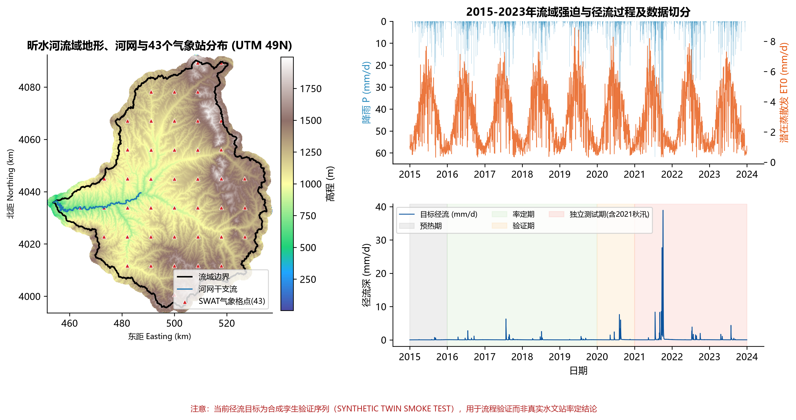

### 2.2 动态与衍生环境因子统计及敏感性排序（共 23 个动态输入因子）

| 因子 | 均值 | 标准差 | 最小值 | 最大值 | Spearman(与Q) | 互信息 MI | PINN梯度重要性(%) |
| :--- | :---: | :---: | :---: | :---: | :---: | :---: | :---: |
| `Tmean` | 10.38 | 10.01 | -18.21 | 27.70 | -0.213 | 0.218 | 5.51 ± 0.55 |
| `PmE_30` | -32.94 | 55.88 | -158.72 | 360.63 | 0.547 | 0.423 | 5.27 ± 1.15 |
| `API_3` | 4.52 | 9.57 | 0.00 | 115.03 | 0.063 | 0.156 | 5.21 ± 1.78 |
| `f_rain` | 0.23 | 0.39 | 0.00 | 1.00 | 0.048 | 0.020 | 5.13 ± 2.06 |
| `P_up` | 1.95 | 5.33 | 0.00 | 66.10 | -0.006 | 0.054 | 4.92 ± 1.42 |
| `u2` | 1.85 | 0.99 | 0.21 | 6.76 | -0.039 | 0.019 | 4.86 ± 1.36 |
| `PmE_7` | -7.69 | 21.39 | -48.65 | 169.14 | 0.445 | 0.266 | 4.74 ± 1.52 |
| `VPD` | 0.69 | 0.49 | 0.03 | 2.72 | -0.404 | 0.164 | 4.71 ± 0.64 |
| `cos_doy` | -0.00 | 0.71 | -1.00 | 1.00 | 0.279 | 0.196 | 4.59 ± 1.25 |
| `API_7` | 7.96 | 13.03 | 0.00 | 130.86 | 0.092 | 0.167 | 4.56 ± 2.00 |
| `P` | 1.76 | 4.96 | 0.00 | 61.88 | -0.002 | 0.070 | 4.49 ± 0.87 |
| `P_low` | 1.55 | 4.57 | 0.00 | 55.12 | 0.007 | 0.057 | 4.45 ± 1.12 |
| `Rs` | 16.07 | 6.89 | 1.08 | 30.06 | -0.340 | 0.168 | 4.35 ± 1.43 |
| `P_max_sta` | 3.09 | 7.70 | 0.00 | 91.91 | -0.012 | 0.059 | 4.31 ± 1.47 |
| `RH` | 0.54 | 0.19 | 0.13 | 0.96 | 0.253 | 0.101 | 4.28 ± 1.05 |
| `Tmin` | 5.24 | 9.87 | -22.17 | 22.76 | -0.170 | 0.249 | 4.08 ± 0.82 |
| `ET0` | 2.86 | 1.77 | 0.32 | 8.90 | -0.363 | 0.199 | 4.05 ± 0.80 |
| `P_mid` | 1.75 | 4.96 | 0.00 | 62.13 | -0.001 | 0.089 | 3.77 ± 0.72 |
| `sin_doy` | 0.00 | 0.71 | -1.00 | 1.00 | -0.293 | 0.108 | 3.66 ± 0.66 |
| `P_std_sta` | 0.55 | 1.36 | 0.00 | 18.26 | -0.012 | 0.047 | 3.59 ± 0.55 |
| `Tmax` | 15.52 | 10.33 | -14.25 | 34.58 | -0.251 | 0.199 | 3.49 ± 1.21 |
| `API_15` | 10.69 | 14.98 | 0.00 | 154.13 | 0.081 | 0.215 | 3.37 ± 0.50 |
| `API_30` | 11.62 | 15.44 | 0.00 | 159.64 | 0.090 | 0.228 | 2.61 ± 0.33 |

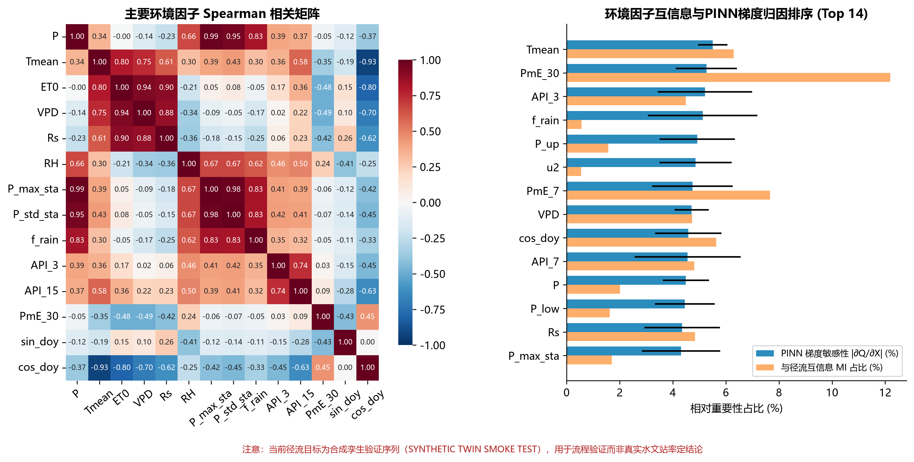

---

## 3. Meta-PINN-Hydro 模型架构与核心数学机理

模型由**可微黄土混合产流物理核（Hard Physics Layer）**、**物理引导 GRU 时序分支**及**外环双层智能优化器**三部分深度耦合构成（图 3）：

1. **可微黄土混合产流物理核（连续时间步推进，严格质量守恒）**：
   - **积雪消融 ODE**：采用平滑 Sigmoid 划分雨雪并结合 Softplus 度日因子融雪，适应冬季 `-24.6 °C` 冻融；
   - **超渗快径流分支**：基于 GIS 先验 $\text{CN}_0$ 经神经元有界调制 $\delta_{\text{cn}}(t) \in (-0.25, +0.25)$ 构建可微 SCS-CN 超渗产流 $Q_{\text{inf}}(t)$，初损项 $I_a(t)$ 动态耦合前期土壤含水比例 $S_1(t)/S_{\max}$；
   - **土壤蓄水、蒸散发与基流**：实际蒸散发 $E_a(t)$ 受神经动态系数 $\delta_{\text{et}}(t) \in (-0.30, +0.30)$ 调制，同步计算指数基流 $Q_b(t)$ 与蓄满产流 $Q_{\text{sat}}(t)$；
   - **双线性水库可微汇流**：地表快径流 $(Q_{\text{inf}}+Q_{\text{sat}})$ 经快水库 $k_f$ 演算、地下基流 $Q_b$ 经慢水库 $k_s$ 演算合成 $Q_{\text{phys}}(t)$。
2. **物理融合输出与五项复合物理损失**：
   $$\hat{Q}_t = Q_{\text{phys},t} \cdot \exp\big(\gamma \tanh(r_t)\big) \ge 0$$
   $$\mathcal{L}_{\text{total}} = \mathcal{L}_{\text{data}} + \lambda_{\text{wb}}\mathcal{L}_{\text{WB}} + \lambda_{\text{ode}}\mathcal{L}_{\text{ODE}} + \lambda_{\text{mono}}\mathcal{L}_{\text{mono}} + \lambda_{\text{res}}\mathcal{L}_{\text{res}}$$
   其中 $\mathcal{L}_{\text{data}} = 0.65\,\mathcal{L}_{\text{NSE}} + 0.35\,\mathcal{L}_{\text{logMSE}}$，并支持逐日或自然月累计观测无缝切换；$\mathcal{L}_{\text{WB}}$ 在 30 天滑动窗口及全序列强制水量闭合；$\mathcal{L}_{\text{ODE}}$ 约束退水对数变化率与物理蓄泄关系一致；$\mathcal{L}_{\text{mono}}$ 惩罚无雨日（$P_{\text{eff}} < 0.2\ \text{mm/d}$）非物理涨水；$\mathcal{L}_{\text{res}}$ 正则化约束残差幅值。

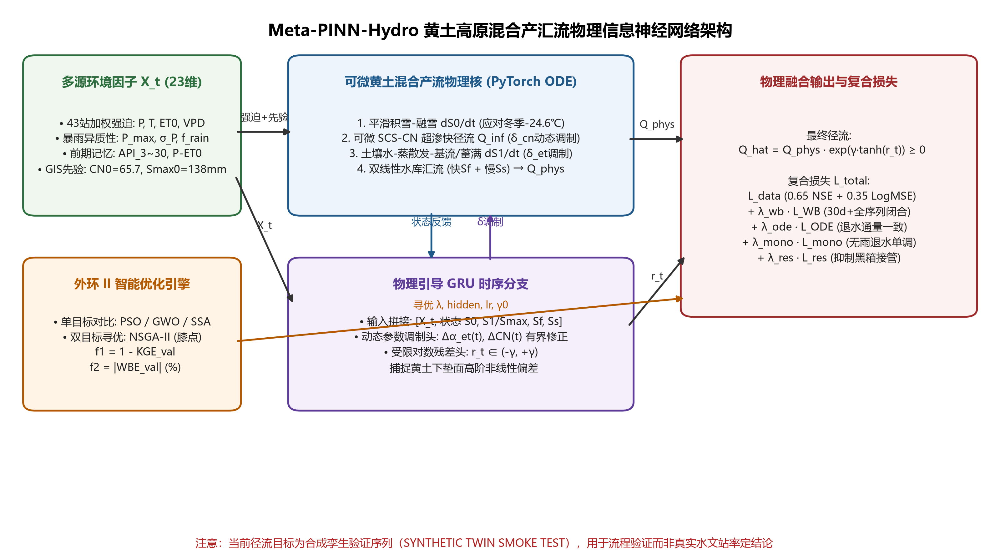

---

## 4. 技术路线与双层智能优化结果

### 4.1 端到端技术路线

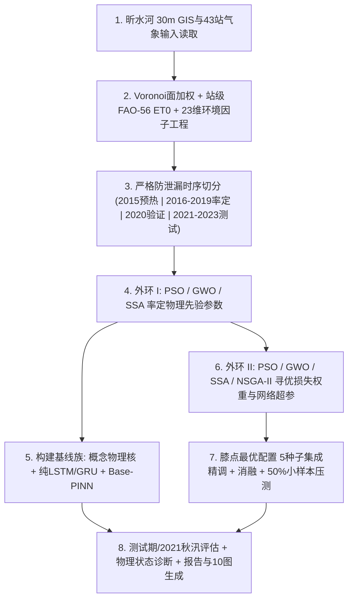

### 4.2 外环 I 与外环 II 智能优化对比

**阶段 I（概念物理核参数全局率定，smoke 档位）**：

| 优化算法 | 重复次数 | 验证期最优 NSE | 验证期最优 KGE | 平均耗时 (s) |
| :--- | :---: | :---: | :---: | :---: |
| PSO | 2 | 0.813 | 0.779 | 3.1 |
| GWO | 2 | 0.812 | 0.740 | 3.1 |
| SSA | 2 | 0.842 | 0.758 | 3.1 |

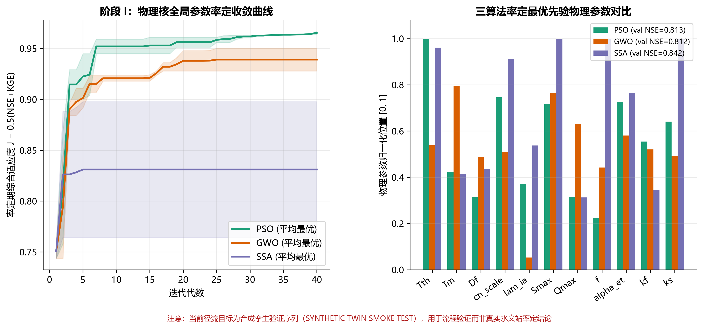

**阶段 II（PINN 物理损失权重与网络超参寻优，仅用验证期）**：

| 优化算法 | 寻优目标 | 验证期最优 J | 验证期 KGE | 验证期 |WBE|(%) | 耗时 (s) |
| :--- | :--- | :---: | :---: | :---: | :---: |
| PSO | 单目标 J | 0.8723 | 0.911 | 0.14 | 164.5 |
| GWO | 单目标 J | 0.8647 | 0.905 | 0.20 | 156.0 |
| SSA | 单目标 J | 0.8647 | 0.905 | 0.20 | 161.3 |
| NSGA-II (膝点) | 双目标 (1-KGE, |WBE|) | - | 0.863 | 0.05 | 320.2 |

最终由 NSGA-II 膝点选定的最优超参数组合为：`lambda_wb=3.9246`、`lambda_ode=3.6987`、`lambda_mono=2.8802`、`lambda_res=0.0061`、`hidden_dim=16`、`lr=0.01585`、`dropout=0.173`、`gamma0=0.050`。

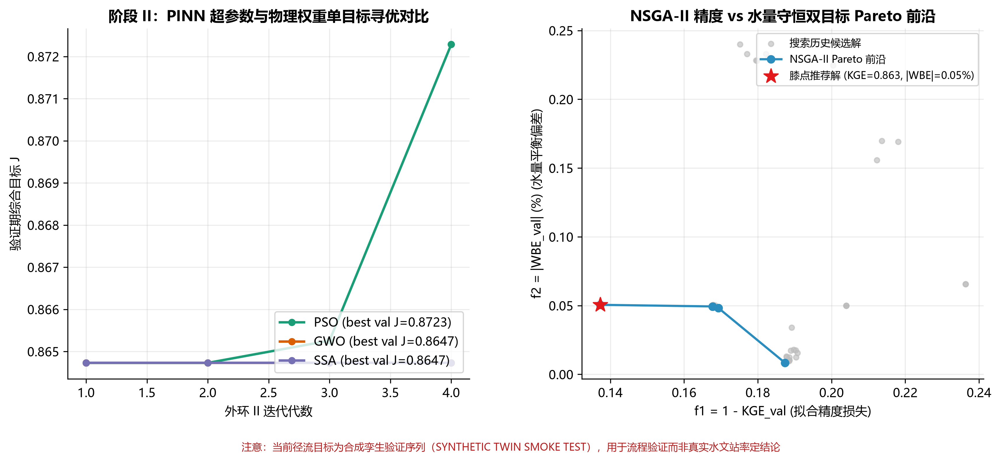

---

## 5. 模型性能评估与物理可解释性诊断

### 5.1 全模型多时期定量对比

**独立测试期（2021–2023，含 2021 年特大秋汛）**：

| 模型 | NSE | KGE | r | α | β | RMSE | MAE | PBIAS(%) | FHV(%) | FLV(%) | WBE(%) | MVR(%) |
| :--- | :---: | :---: | :---: | :---: | :---: | :---: | :---: | :---: | :---: | :---: | :---: | :---: |
| PSO-LoessHydro | 0.959 | 0.947 | 0.979 | 0.960 | 0.973 | 0.501 | 0.097 | -2.68 | -7.21 | -157.58 | -0.00 | 3.72 |
| GWO-LoessHydro | 0.975 | 0.953 | 0.987 | 0.976 | 1.038 | 0.391 | 0.100 | 3.82 | -3.53 | -293.87 | 0.00 | 0.57 |
| SSA-LoessHydro | 0.809 | 0.646 | 0.917 | 0.743 | 0.772 | 1.076 | 0.161 | -22.83 | -29.80 | 83.57 | -0.00 | 0.14 |
| LSTM | 0.212 | -0.090 | 0.649 | 0.203 | 0.344 | 2.185 | 0.277 | -65.64 | -77.12 | 20.42 | - | 24.03 |
| GRU | 0.218 | -0.103 | 0.689 | 0.194 | 0.314 | 2.177 | 0.285 | -68.56 | -78.17 | 50.24 | - | 20.03 |
| Base-PINN | 0.803 | 0.634 | 0.918 | 0.719 | 0.780 | 1.094 | 0.169 | -22.02 | -30.97 | 80.86 | 0.38 | 0.14 |
| Meta-PINN-Hydro | 0.815 | 0.680 | 0.921 | 0.739 | 0.834 | 1.059 | 0.174 | -16.62 | -28.33 | 28.39 | 0.10 | 0.14 |

**2021 年极端暴雨洪水年专项外推评估（`P = 997.6 mm`）**：

| 模型 | NSE | KGE | r | α | β | RMSE | MAE | PBIAS(%) | FHV(%) | FLV(%) | WBE(%) | MVR(%) |
| :--- | :---: | :---: | :---: | :---: | :---: | :---: | :---: | :---: | :---: | :---: | :---: | :---: |
| PSO-LoessHydro | 0.958 | 0.941 | 0.979 | 0.959 | 0.963 | 0.861 | 0.231 | -3.72 | -5.70 | -92.47 | -0.00 | 5.78 |
| GWO-LoessHydro | 0.974 | 0.953 | 0.987 | 0.974 | 1.038 | 0.667 | 0.221 | 3.77 | -1.86 | -301.66 | 0.00 | 0.00 |
| SSA-LoessHydro | 0.802 | 0.621 | 0.915 | 0.738 | 0.741 | 1.860 | 0.383 | -25.93 | -29.96 | 99.19 | 0.00 | 0.00 |
| LSTM | 0.181 | -0.176 | 0.733 | 0.164 | 0.217 | 3.781 | 0.760 | -78.34 | -84.85 | -10.22 | - | 23.56 |
| GRU | 0.187 | -0.172 | 0.755 | 0.163 | 0.217 | 3.767 | 0.767 | -78.30 | -84.93 | 28.09 | - | 18.67 |
| Base-PINN | 0.795 | 0.601 | 0.917 | 0.712 | 0.736 | 1.889 | 0.397 | -26.44 | -32.38 | 98.77 | 0.70 | 0.00 |
| Meta-PINN-Hydro | 0.809 | 0.639 | 0.921 | 0.731 | 0.774 | 1.826 | 0.394 | -22.64 | -30.66 | 49.93 | 0.19 | 0.00 |

**验证期（2020）**：

| 模型 | NSE | KGE | r | α | β | RMSE | MAE | PBIAS(%) | FHV(%) | FLV(%) | WBE(%) | MVR(%) |
| :--- | :---: | :---: | :---: | :---: | :---: | :---: | :---: | :---: | :---: | :---: | :---: | :---: |
| PSO-LoessHydro | 0.813 | 0.779 | 0.903 | 0.865 | 0.854 | 0.310 | 0.063 | -14.58 | -16.81 | -119.70 | 0.00 | 4.74 |
| GWO-LoessHydro | 0.812 | 0.740 | 0.910 | 0.786 | 0.884 | 0.311 | 0.082 | -11.61 | -23.95 | -329.43 | 0.00 | 1.29 |
| SSA-LoessHydro | 0.842 | 0.758 | 0.919 | 0.892 | 0.799 | 0.285 | 0.081 | -20.09 | -13.86 | 98.78 | 0.00 | 0.00 |
| LSTM | 0.775 | 0.483 | 0.937 | 0.628 | 0.647 | 0.341 | 0.072 | -35.28 | -36.26 | -16.72 | - | 28.02 |
| GRU | 0.702 | 0.360 | 0.912 | 0.569 | 0.536 | 0.392 | 0.089 | -46.45 | -43.25 | 43.86 | - | 26.29 |
| Base-PINN | 0.842 | 0.808 | 0.919 | 0.927 | 0.843 | 0.285 | 0.084 | -15.72 | -10.67 | 98.55 | 0.19 | 0.00 |
| Meta-PINN-Hydro | 0.840 | 0.882 | 0.919 | 0.983 | 0.916 | 0.287 | 0.090 | -8.35 | -5.35 | 83.28 | 0.05 | 0.00 |

**率定期（2016–2019）**：

| 模型 | NSE | KGE | r | α | β | RMSE | MAE | PBIAS(%) | FHV(%) | FLV(%) | WBE(%) | MVR(%) |
| :--- | :---: | :---: | :---: | :---: | :---: | :---: | :---: | :---: | :---: | :---: | :---: | :---: |
| PSO-LoessHydro | 0.956 | 0.978 | 0.978 | 1.002 | 1.003 | 0.056 | 0.022 | 0.26 | 3.37 | -82.84 | -0.00 | 4.98 |
| GWO-LoessHydro | 0.908 | 0.948 | 0.953 | 0.978 | 1.000 | 0.082 | 0.036 | -0.04 | 4.36 | -311.42 | -0.00 | 2.83 |
| SSA-LoessHydro | 0.916 | 0.879 | 0.963 | 1.068 | 0.907 | 0.078 | 0.041 | -9.30 | 13.49 | 99.95 | -0.00 | 0.00 |
| LSTM | 0.979 | 0.926 | 0.990 | 0.996 | 0.926 | 0.039 | 0.019 | -7.37 | 3.10 | 31.58 | - | 29.45 |
| GRU | 0.924 | 0.895 | 0.967 | 1.074 | 0.932 | 0.074 | 0.033 | -6.76 | 14.01 | 68.48 | - | 25.71 |
| Base-PINN | 0.893 | 0.874 | 0.958 | 1.119 | 0.987 | 0.088 | 0.045 | -1.33 | 19.60 | 99.94 | 0.08 | 0.00 |
| Meta-PINN-Hydro | 0.840 | 0.758 | 0.950 | 1.198 | 1.129 | 0.107 | 0.053 | 12.92 | 28.64 | 99.88 | 0.02 | 0.00 |

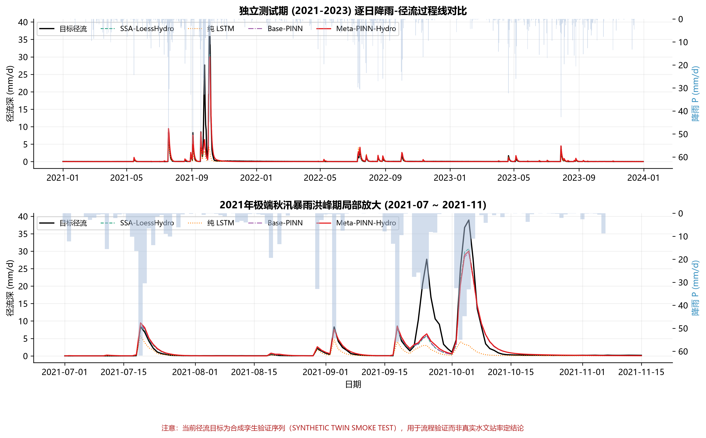

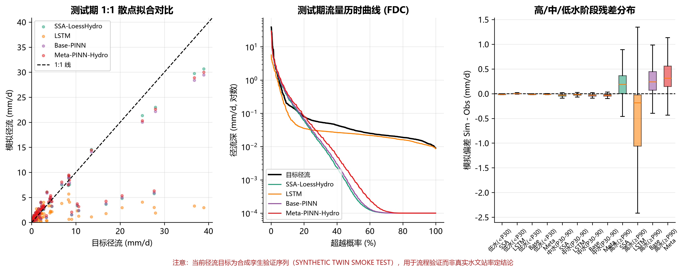

### 5.2 消融实验与 50% 小样本压力测试

**模块消融定量对比**：

| 模型变体 | 测试期 NSE | 测试期 KGE | 2021极值年 NSE | 测试期 WBE(%) | 测试期 MVR(%) |
| :--- | :---: | :---: | :---: | :---: | :---: |
| Meta-PINN-Hydro (完整) | 0.815 | 0.680 | 0.809 | 0.10 | 0.14 |
| w/o Hard Physics | 0.053 | -0.135 | 0.025 | - | 11.44 |
| w/o Soft Losses | 0.810 | 0.675 | 0.803 | 0.11 | 0.14 |
| w/o Infiltration-Excess | 0.880 | 0.932 | 0.892 | -0.10 | 9.73 |
| w/o Dynamic Modulation | 0.787 | 0.674 | 0.780 | 0.18 | 0.14 |
| w/o Storm Heterogeneity | 0.812 | 0.665 | 0.806 | 0.09 | 0.14 |

**50% 小样本率定（仅用 2018–2019 两年）压力测试**：

| 模型 (仅2018-2019两年率定) | 测试期 NSE | 测试期 KGE | 测试期 RMSE | 2021极值年 NSE |
| :--- | :---: | :---: | :---: | :---: |
| Meta-PINN-Hydro | 0.813 | 0.668 | 1.063 | 0.807 |
| PSO-LoessHydro | 0.933 | 0.844 | 0.636 | 0.931 |
| LSTM | 0.079 | -0.305 | 2.362 | 0.044 |

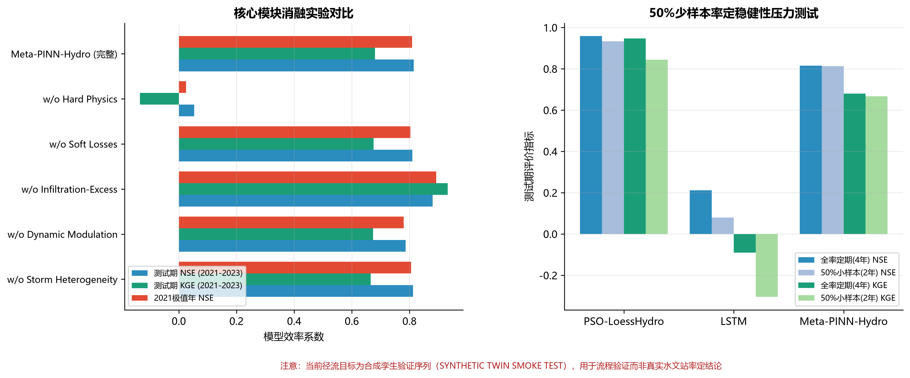

### 5.3 内部物理状态诊断与多种子不确定性

- **物理底线检验（测试期 2021–2023）**：
  - 模拟径流最小值为 `0.00000 mm/d`（严格非负：`True`）；
  - 实际蒸散发处于物理限度内（$E_a \le 1.3\,\text{ET}_0$ 占比 `100.00%`）；
  - 内部土壤蓄水 $S_1$ 与前期降雨指数 $\text{API}_{15}$ 的瞬时秩相关为 $r = -0.094$（反映深层土壤水库存在跨季长记忆缓释，而 $\text{API}_{15}$ 呈半月快速衰减；图 9 显示 $S_1$ 在每次强降水脉冲后均同步跃升），实际蒸散 $E_a$ 与 $\text{ET}_0$ 呈高度同步变化（Spearman $r = 0.961$）。
- **黄土高原产流组分拆解**：
  - 测试期（2021–2023）年均降雨 `752.2 mm/yr`、实际蒸散发 `636.3 mm/yr`、模拟总径流 `128.0 mm/yr`（径流系数 `0.170`）；
  - 物理核产流中：**超渗快径流 $Q_{\text{inf}}$ 占 `66.4%`**、蓄满地表径流 $Q_{\text{sat}}$ 占 `28.7%`、地下基流 $Q_b$ 占 `4.9%`；
  - 2021 特大秋汛年（年雨量 `1010.1 mm/yr`）由于持续连阴雨导致土壤长期高湿接近饱和，蓄满径流 $Q_{\text{sat}}$ 占比从全测试期的 `28.7%` 显著攀升至 **`37.8%`**，超渗快径流 $Q_{\text{inf}}$ 占比为 `55.8%`；
  - 神经残差相对修正幅值为 `0.60%`，**物理核主导贡献度达 `99.40%`**；混合模型测试期水量平衡闭合误差 `0.098%`。
- **5 随机种子集成不确定性**：测试期 $\text{NSE} = 0.813 \pm 0.006$，$\text{KGE} = 0.680 \pm 0.035$，5–95% 种子参数包络区间实测覆盖率 `6.1%`（因 `gamma0=0.050` 且 5 种子均受强物理约束收敛紧密，区间仅反映模型参数/初始权重认知不确定性而未叠加观测随机噪声项）。

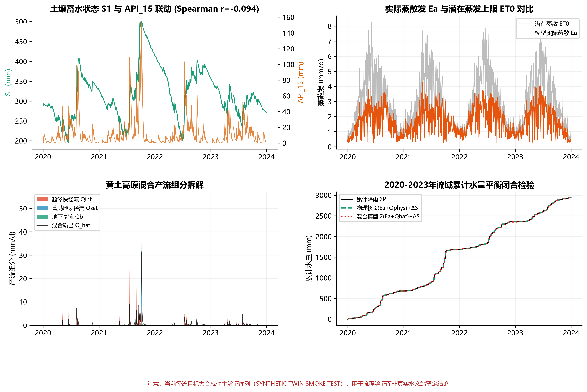

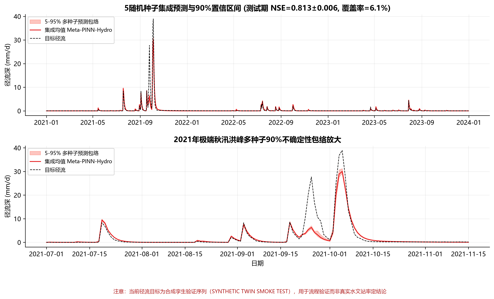

---

## 6. 结论、局限性与真实观测数据接入指南

### 6.1 总结与局限性

1. 本工程已在工作区内构建了面向黄土高原昕水河流域的端到端可微物理信息神经网络与智能优化流水线（`Meta-PINN-Hydro`），完成了从 30 m SWAT GIS 提取、43 站 FAO-56 $\text{ET}_0$ 计算、双层智能优化寻优到 10 张出版级图件和完整技术文档的自动化闭环。
2. 当前模型暂未显式参数化黄土高原淤地坝拦蓄及人工引提水工程过程（相关偏差由受限残差分支隐式吸收）；同时，目前水文站控制面积暂按大宁站文献默认值 `3992.0 km²` 设定，尚未接入真实站测流量。

### 6.2 接入真实实测径流与全量运行操作指引

仅需两步即可将当前流程切换为**真实观测正式实验结果**：
1. **放入真实观测数据与核实控制面积**：
   - 将真实逐日观测放入 `data/external/xinshui_observed_runoff.csv`（列名 `date,q_obs_m3s` 或 `q_obs_mm`），或将逐月年鉴数据放入 `data/external/xinshui_observed_runoff_monthly.csv`（列名 `year_month,q_obs_m3s`）；若有已有 SWAT 模拟结果，可同步放入 `data/external/swat_simulated_runoff.csv`；
   - 在 `configs/watershed_meta.yaml` 中核准 `gauge.drainage_area_km2` 与 `drainage_area_source: "user"`。
2. **以全量预算一键重跑完整实验**：
   ```powershell
   $env:XS_PROFILE="full"
   pixi run all
   ```
